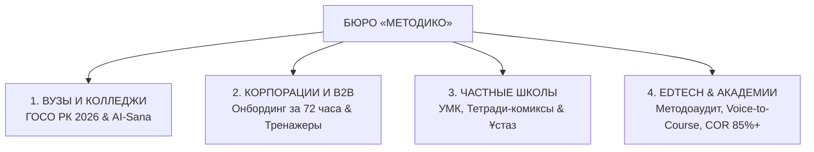
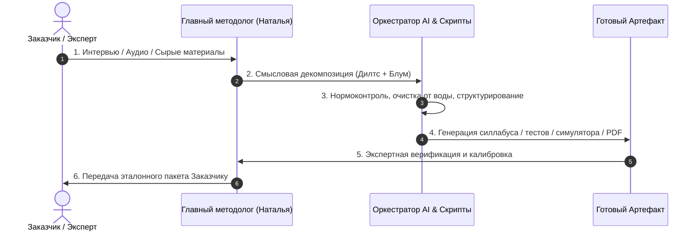

# 📖 КНИГА МЕТОДИКО: АРХИТЕКТУРА, СТАНДАРТЫ И ПОЛНЫЙ СВОД ДОКУМЕНТОВ БЮРО

> **Официальный свод стандартов и регламентов бюро «МЕТОДИКО»**  
> **Юридическое лицо:** ТОО «Метод и Ко» (г. Алматы, Республика Казахстан)  
> **Основатель и главный методолог:** [[ПАСПОРТ_КОМПЕТЕНЦИЙ_НАТАЛЬИ|Наталья Коденцева]] — Магистр педагогики, эксперт высшей школы по нормоконтролю и проектированию образовательных систем (24 года научно-педагогической и руководящей практики)  
> **Официальный веб-портал:** https://metodico-kz.netlify.app/  
> **Контакты:** Телефон / WhatsApp: `+7 (700) 077-35-66`

---

## СОДЕРЖАНИЕ КНИГИ

1. [РАЗДЕЛ I. Бизнес-манифест и методологический фундамент бюро «МЕТОДИКО»](#раздел-i-бизнес-манифест-и-методологический-фундамент-бюро-методико)
   - 1.1. Инженерный бизнес-стандарт: Системный нормоконтроль и Развивающая методология
   - 1.2. Профессиональный профиль и фундамент основателя
   - 1.3. Теоретический базис (Дилтс, Блум, Грейвз, Свеллер, CustDev, ФКР)
2. [РАЗДЕЛ II. Продуктовая экосистема: 4 флагманских направления](#раздел-ii-продуктовая-экосистема-4-флагманских-направления)
   - 2.1. Направление 1: Академический сектор (ГОСО РК 2026, «AI-Sana», «AI + X», Platonus/Moodle)
   - 2.2. Направление 2: Корпоративный сектор (Онбординг за 72 часа, диалоговые HTML5/SCORM симуляторы)
   - 2.3. Направление 3: Школьный сектор (Частные школы, авторские УМК, тетради-комиксы, аттестация «Ұстаз»)
   - 2.4. Направление 4: EdTech и Корпоративные академии (Методоаудит, Drop-off карта, Voice-to-Course, COR 85%+)
3. [РАЗДЕЛ III. Производственный конвейер и технологии разработки](#раздел-iii-производственный-конвейер-и-технологии-разработки)
   - 3.1. Технология Voice-to-Course: Сборка эталонных курсов и книг из аудио
   - 3.2. Архитектура интерактивных симуляторов переговоров
   - 3.3. Полиграфический стандарт рабочих тетрадей (Pre-press PDF)
4. [РАЗДЕЛ IV. Бронебойный юридический и финансовый каркас (Стандарт РК 2026)](#раздел-iv-бронебойный-юридический-и-финансовый-каркас-стандарт-рк-2026)
   - 4.1. Реквизиты и правовой статус ТОО «Метод и Ко»
   - 4.2. Механика защиты от потребительского экстремизма (лимит 3 правок, день-в-день, автоприемка, невозвратность)
   - 4.3. Финансовая политика, себестоимость и маржинальность
5. [РАЗДЕЛ V. Стратегия B2B-экспансии и каналы дистрибуции](#раздел-v-стратегия-b2b-экспансии-и-каналы-дистрибуции)
   - 5.1. Персонализированный аутрич (Вузы, Корпорации, Школы)
   - 5.2. Демо-воронка через интерактивный веб-симулятор
6. [РАЗДЕЛ VI. Сводный реестр документов и ссылочная матрица](#раздел-vi-сводный-реестр-документов-и-ссылочная-матрица)

---

## РАЗДЕЛ I. БИЗНЕС-МАНИФЕСТ И МЕТОДОЛОГИЧЕСКИЙ ФУНДАМЕНТ БЮРО «МЕТОДИКО»

### 1.1. Инженерный бизнес-стандарт: Системный нормоконтроль и Развивающая методология

Бюро стандартов «МЕТОДИКО» выстроено на стыке двух ключевых принципов:

```
┌────────────────────────────────────────────────────────┐
│             ИНЖЕНЕРНЫЙ БИЗНЕС-СТАНДАРТ «МЕТОДИКО»      │
├───────────────────────────┬────────────────────────────┤
│   СИСТЕМНЫЙ НОРМОКОНТРОЛЬ │   ПРИКЛАДНАЯ БИЗНЕС-       │
│  (Управленческая точность)│   МЕТОДОЛОГИЯ (ROI & COR)  │
├───────────────────────────┼────────────────────────────┤
│ • 24 года экспертного стажа│ • Фокус на окупаемости (ROI)│
│ • Технологическая дисциплина│ • Доходимость COR 85%+   │
│ • Нулевая толерантность    │ • Развивающая обратная     │
│   к хаосу и «воде»        │   связь без демотивации    │
│ • 100% соответствие ГОСО  │ • Практические тренажеры   │
│ • Измеримые KPI и регламенты│ • Измеримые дескрипторы  │
└───────────────────────────┴────────────────────────────┘
```

1. **Системный нормоконтроль (экспертная проверка соответствия образовательных программ государственным стандартам и регламентам):**
   * Каждый образовательный продукт проектируется как четкий регламент: каждая цель обучения калибруется, каждое действие ученика или сотрудника диагностируется, исключаются двусмысленности, «вода» и хаотичные отступления.
   * Нормоконтроль документации проводится по высшим стандартам государственной аккредитации и корпоративных регламентов.
2. **Прикладная бизнес-методология (ориентация на окупаемость и измеримый результат):**
   * Уважение к рабочему времени обучающихся и ресурсам бизнеса.
   * Методология развивающей обратной связи: акцент на практических бизнес-кейсах, фиксации побед и точек роста вместо демотивирующего штрафования за ошибки.
   * Приемы поддерживающего наставничества и точечной индивидуальной подсказки (деликатная коррекция навыка без публичного стыжения).

---

### 1.2. Профессиональный профиль и фундамент основателя

* **Основатель:** **Наталья Коденцева** — Магистр педагогики, признанный главный методолог образовательных программ.
* **Трудовой стаж:** Более 24 лет непрерывной научно-педагогической, нормоконтрольной и административно-руководящей деятельности в системе высшего образования и прикладной подготовки кадров.
* **Портфолио реализованных программ:**
  * Автор и архитектор **более 300 курсов, учебных дисциплин и программ** всех направлений и масштабов (от фундаментальных университетских программ до прикладных корпоративных онбордингов).
  * Разработчик программ повышения квалификации профессорско-преподавательского состава Казахского национального университета им. аль-Фараби в рамках государственного заказа (Договор № ОИ-ЦП-1-25).
  * Методолог социально значимого детского проекта безопасности «Миссия 112».
  * Архитектор систем дошкольного и раннего развития детей (включая стандарты сетей развития и программы «Жаңа Ұрпақ 365»).
  * Автор сертифицированного флагманского курса «Сам себе методолог» (Свидетельство о депонировании объекта авторских прав № 2215094 от 28.03.2024 г., международная регистрация IREG/InterPatent).

---

### 1.3. Теоретический базис и методологический инструментарий

В методологический арсенал бюро заложены признанные мировые научные концепции:

1. **Обратный дизайн (Backward Design — проектирование курса от конечного измеримого результата к учебному содержанию, методология Г. Уиггинса и Дж. Мактига):**
   Проектирование курса начинается не с лекций, а с фиксации целевого результата:
   $$\text{Целевой результат (Что делает выпускник)} \longrightarrow \text{Критерии оценки (Как докажем)} \longrightarrow \text{Учебные активности (Как научим)}$$
2. **Таксономия Блума в редакции Андерсона и Кратволя (Bloom's Revised Taxonomy — международная шкала классификации учебных целей от знания терминов к практическому анализу и созданию решений):**
   Исключение размытых глаголов («понимать», «ознакомиться»). Использование глаголов действия: *рассчитать, спроектировать, валидировать, устранить, составить*.
3. **Пирамида логических уровней Роберта Дилтса (системная модель перехода от уровня цены и условий к ценностям, роли и измеримой бизнес-выгоде):**
   Перевод процесса обучения и продаж с уровней «Окружение» и «Поведение» на уровни «Способности», «Ценности» и «Идентичность».
4. **Спиральная динамика доктора Клэра Грейвза (Spiral Dynamics — модель диагностики и адаптации обучения под уровень корпоративной культуры организации):**
   Адаптация корпоративных программ под доминирующую культуру организации (от культуры правил и стандартов до культуры личных побед и командного согласия).
5. **Матрица проблемных интервью CustDev (Customer Development — качественное исследование скрытых болей и возражений клиентов) и ФКР (Функциональная карта роли — детальный реестр трудовых действий и зон ответственности сотрудника):**
   Каждая строчка учебной программы отвечает на реальную выявленную «боль» и функциональную обязанность специалиста.
6. **Теория когнитивной нагрузки Джона Свеллера (Cognitive Load Theory — устранение перегрузки восприятия через микроформаты и наглядную структуризацию):**
   Устранение посторонней когнитивной нагрузки (extraneous load) через микроформаты, инфографику и четкие визуальные чек-листы.

---

## РАЗДЕЛ II. ПРОДУКТОВАЯ ЭКОСИСТЕМА: 4 ФЛАГМАНСКИХ НАПРАВЛЕНИЯ



---

### 2.1. Направление 1: Академический сектор (ГОСО РК 2026, «AI-Sana», «AI + X», Platonus/Moodle)

* **Целевая аудитория:** Проректоры по академическим вопросам, деканаты, заведующие кафедрами вузов и директора колледжей (ТиПО) Казахстана.
* **Главный рыночный триггер:** Регуляторные требования МНВО РК 2026 года по внедрению национальной программы «AI-Sana», модели «AI + X», обязательной политике допустимого применения генеративного ИИ в силлабусах и тотальной валидации фондов оценочных средств (ФОС).
* **Созданные артефакты бюро:**
  * **Whitepaper стандарта:** [whitepaper-goso-2026.html](file:///c:/Users/Dell/Desktop/РАБОЧАЯ_ЗОНА/МЕТОДОЛОГИЯ/_ПРОЕКТ_ИССЛЕДОВАНИЕ_И_САЙТ/whitepaper-goso-2026.html)
  * **Техническое задание к договору:** [Приложение № 1 (Вузы и колледжи)](file:///c:/Users/Dell/Desktop/РАБОЧАЯ_ЗОНА/МЕТОДОЛОГИЯ/ТОО%20Метод%20и%20Ко/ДОГОВОР_2026/Приложение_1_ТЗ_ВУЗЫ_КОЛЛЕДЖИ_ГОСО_2026.md)
  * **B2B-обращение:** [Письмо ректоратам и деканатам](file:///c:/Users/Dell/Desktop/РАБОЧАЯ_ЗОНА/МЕТОДОЛОГИЯ/ТОО%20Метод%20и%20Ко/РАССЫЛКА_B2B/ПИСЬМО_1_РЕКТОРАТАМ_И_ДЕКАНАТАМ_ВУЗОВ.md)
* **Состав эталонного пакета:**
  1. Силлабус по ГОСО РК 2026 с регламентом «AI Policy 2026» и активными глаголами Блума (15 недель семестра);
  2. Банк из 100 тестовых заданий ФОС в кодировке UTF-8 (форматы GIFT / Aiken) для бесшовного импорта в Platonus / Moodle за 3 секунды;
  3. Критериальные рубрикаторы для рубежного контроля (РК-1, РК-2, сессия);
  4. Интерактивная HTML-панель запуска дисциплины для студентов.
* **Ценообразование:** 180 000 ₸ за дисциплину; кафедральный цикл (до 5–6 дисциплин) — **950 000 ₸**.

---

### 2.2. Направление 2: Корпоративный сектор (Онбординг за 72 часа, диалоговые HTML5/SCORM симуляторы)

* **Целевая аудитория:** Генеральные директора, коммерческие директора (CCO), директора по продажам (РОП) и HRD компаний сегментов B2B и B2C.
* **Главный рыночный триггер:** Новички в продажах «сливают» от 35% до 50% целевого рекламного трафика в первые недели работы из-за страха возражений («Қымбат / Дорого», «Скиньте на WhatsApp», «Я подумаю»), а классическая адаптация отнимает месяц времени РОПа.
* **Созданные артефакты бюро:**
  * **Whitepaper стандарта:** [whitepaper-corporate-sales.html](file:///c:/Users/Dell/Desktop/РАБОЧАЯ_ЗОНА/МЕТОДОЛОГИЯ/_ПРОЕКТ_ИССЛЕДОВАНИЕ_И_САЙТ/whitepaper-corporate-sales.html)
  * **Действующий интерактивный симулятор:** [case-1-sales-simulator.html](file:///c:/Users/Dell/Desktop/РАБОЧАЯ_ЗОНА/МЕТОДОЛОГИЯ/_ПРОЕКТ_ИССЛЕДОВАНИЕ_И_САЙТ/case-1-sales-simulator.html)
  * **Техническое задание к договору:** [Приложение № 2 (Корпоративный онбординг)](file:///c:/Users/Dell/Desktop/РАБОЧАЯ_ЗОНА/МЕТОДОЛОГИЯ/ТОО%20Метод%20и%20Ко/ДОГОВОР_2026/Приложение_2_ТЗ_КОРПОРАТИВНЫЙ_ОНБОРДИНГ_И_ТРЕНАЖЕРЫ.md)
  * **B2B-обращение:** [Письмо генеральным директорам и РОПам](file:///c:/Users/Dell/Desktop/РАБОЧАЯ_ЗОНА/МЕТОДОЛОГИЯ/ТОО%20Метод%20и%20Ко/РАССЫЛКА_B2B/ПИСЬМО_2_ГЕНЕРАЛЬНЫМ_ДИРЕКТОРАМ_И_РОПАМ.md)
* **Состав эталонного пакета:**
  1. Интерактивный диалоговый HTML5/SCORM-симулятор (до 3 ключевых практических сценариев: квалификация, отработка «Қымбат/Дорого», дожим КП) с аудиорепликами клиентов и расчетом баллов;
  2. Дорожная карта онбординга «Сотрудник в строю за 72 часа» (День 1 — правила и продукт; День 2 — тренажер до балла 85+; День 3 — выход в реальные звонки под контролем наставника);
  3. Стандарт операционных процедур (SOP — Standard Operating Procedure) и практический скрипт-бук (рабочая книга эталонных речевых модулей) с учетом казахской и русской деловой культуры;
  4. Чек-лист контроля качества звонков (QA / Audit Sheet — лист оценки для РОПа) для автоматизированного аудита разговоров.
* **Ценообразование:** Базовый симулятор на 3 сценария — **650 000 ₸**; Корпоративный комплекс Enterprise — **1 200 000 ₸**.

---

### 2.3. Направление 3: Школьный сектор (Частные школы, авторские УМК, тетради-комиксы, аттестация «Ұстаз»)

* **Целевая аудитория:** Учредители, директора частных школ, лицеев, гимназий и авторских образовательных центров.
* **Главный рыночный триггер:** Родители требуют доказательств эксклюзивности платного обучения и жалуются на сухие типовые учебники; сильные педагоги перегружены и не успевают собирать портфолио к аттестации «Ұстаз» (педагог-модератор, сарапшы, зерттеуші, шебер).
* **Созданные артефакты бюро:**
  * **Whitepaper стандарта:** [whitepaper-ustaz-school.html](file:///c:/Users/Dell/Desktop/РАБОЧАЯ_ЗОНА/МЕТОДОЛОГИЯ/_ПРОЕКТ_ИССЛЕДОВАНИЕ_И_САЙТ/whitepaper-ustaz-school.html)
  * **Техническое задание к договору:** [Приложение № 3 (Школы и «Ұстаз»)](file:///c:/Users/Dell/Desktop/РАБОЧАЯ_ЗОНА/МЕТОДОЛОГИЯ/ТОО%20Метод%20и%20Ко/ДОГОВОР_2026/Приложение_3_ТЗ_ШКОЛЫ_АВТОРСКИЕ_УМК_И_ТЕСТ_УСТАЗ.md)
  * **B2B-обращение:** [Письмо учредителям и директорам школ](file:///c:/Users/Dell/Desktop/РАБОЧАЯ_ЗОНА/МЕТОДОЛОГИЯ/ТОО%20Метод%20и%20Ко/РАССЫЛКА_B2B/ПИСЬМО_3_ДИРЕКТОРАМ_ЧАСТНЫХ_ШКОЛ_И_ЛИЦЕЕВ.md)
* **Состав эталонного пакета:**
  1. Авторская учебная программа и Календарно-тематический план (КТП на 34 или 68 часов) по обновленным нормам Минпросвещения РК;
  2. Оригинал-макет фирменной Рабочей тетради-комикса (Pre-press PDF — полиграфический оригинал-макет CMYK, 300 DPI, векторная графика, до 40–60 полос) — осязаемый премиальный продукт школы для печати в типографии;
  3. Критериальный аппарат: формулировки и рубрикаторы для ФО (формативного оценивания), СОР (суммативного за раздел) и СОЧ (за четверть);
  4. Аттестационный паспорт программы с официальной рецензией магистра педагогики для защиты квалификационной категории на экспертном совете.
* **Ценообразование:** Предпечатная верстка тетради-комикса — **180 000 ₸**; Авторский спецкурс (34 ч) — **350 000 ₸**; Флагманский комплекс (68 ч + тетрадь + «Ұстаз») — **850 000 ₸**.

---

### 2.4. Направление 4: EdTech и Корпоративные академии (Методоаудит, Drop-off карта, Voice-to-Course, COR 85%+)

* **Целевая аудитория:** Владельцы онлайн-школ, продюсеры экспертов, руководители корпоративных университетов и L&D отделов (Learning & Development — обучение и развитие персонала).
* **Главный рыночный триггер:** Средняя доходимость онлайн-курсов на рынке СНГ составляет всего 12–18%. Студенты тонут в часовых «говорящих головах», срывают дедлайны домашних заданий и требуют возвратов. Эксперты выгорают на этапе написания методических материалов.
* **Созданные артефакты бюро:**
  * **Whitepaper стандарта:** [whitepaper-edtech-audit.html](file:///c:/Users/Dell/Desktop/РАБОЧАЯ_ЗОНА/МЕТОДОЛОГИЯ/_ПРОЕКТ_ИССЛЕДОВАНИЕ_И_САЙТ/whitepaper-edtech-audit.html)
  * **Техническое задание к договору:** [Приложение № 4 (EdTech и Voice-to-Course)](file:///c:/Users/Dell/Desktop/РАБОЧАЯ_ЗОНА/МЕТОДОЛОГИЯ/ТОО%20Метод%20и%20Ко/ДОГОВОР_2026/Приложение_4_ТЗ_EDTECH_АУДИТ_И_VOICE_TO_COURSE.md)
* **Состав эталонного пакета:**
  1. Экспертное заключение аудита и Карта оттока (Drop-off Map — тепловая карта точек ухода с курса) с поурочным выявлением когнитивных барьеров;
  2. Voice-to-Course распаковка: перевод аудиозаписей эксперта (до 3–6 часов) в структурированные сценарии микроуроков (по 7–12 мин), саммари и конспекты;
  3. Критериальная шкала проверки практических заданий для службы кураторов (регламент ответа за 15 минут по стандарту развивающей обратной связи);
  4. Оригинал-макет Рабочей тетради студента (Student Workbook — практический воркбук) для закрепления навыка.
* **Ценообразование:** Экспресс-аудит + Drop-off карта — **250 000 ₸**; Voice-to-Course модуль — **550 000 ₸**; Флагманский онлайн-курс под ключ (COR 85%+) — **1 100 000 ₸**.

---

## РАЗДЕЛ III. ПРОИЗВОДСТВЕННЫЙ КОНВЕЙЕР И ТЕХНОЛОГИИ РАЗРАБОТКИ



### 3.1. Технология Voice-to-Course: Сборка эталонных курсов и книг из аудио

Самый частый барьер экспертов — невозможность сесть и написать структурированный текст («нет времени писать методичку на 100 страниц»).

**Регламент Voice-to-Course в «МЕТОДИКО»:**
1. **Глубинная сессия распаковки (1,5–3 часа аудио):** Методолог ведет эксперта по матрице логических уровней, задавая фокусирующие вопросы («Какое первое действие делает новичок?», «В чем главная ошибка?», «Как отличить плохой результат от блестящего?»).
2. **Фоновая транскрибация и очистка:** Аудио переводится в текст, удаляются слова-паразиты, междометия и смысловые повторы.
3. **Методологическая сборка:** Текст квантуется на микромодули:
   * *Крючок внимания (Hook) — 1 минута;*
   * *Концептуальное правило (Rule) — 3 минуты;*
   * *Разбор кейса / антикейса (Case Study) — 4 минуты;*
   * *Пошаговый алгоритм действия (SOP) — 2 минуты;*
   * *Конкретное практическое задание (Action Item) — 2 минуты.*
4. **Сборка книги / воркбука:** Вся программа верстается в единый методический свод с таблицами, схемами и чек-листами.

---

### 3.2. Архитектура интерактивных диалоговых тренажеров (HTML5 / SCORM)

Диалоговый симулятор «МЕТОДИКО» — это автономное веб-приложение, работающее на нативном стекe (HTML5, modern CSS, vanilla JavaScript):
* **Полная автономность:** Не требует установки сторонних серверов или баз данных. Запускается локально двойным кликом на любом компьютере, смартфоне или встраивается через `<iframe>` в любую корпоративную систему (Bitrix24, AmoCRM, WebTutor, Teachbase, GetCourse, Moodle).
* **Сценарный движок:** Представляет собой ориентированный граф (дерево состояний). В каждом узле диалога воспроизводится аудиозапись реплики клиента (с использованием Web Audio API / синтеза речи) и отображаются 3 варианта ответа менеджера:
  * *Критическая ошибка (минус балл, переход на ветку ухода клиента);*
  * *Посредственный ответ (нейтральный балл, затягивание разговора);*
  * *Эталонная отработка (максимальный балл, раскрытие возражения по Дилтсу, переход к закрытию сделки).*
* **Аналитический блок:** Ведет подсчет итоговой конверсии, тайминг времени реакции и выдает подробную рецензию с объяснением допущенных ошибок.

---

### 3.3. Полиграфический стандарт рабочих тетрадей (Pre-press PDF)

Для исключения затрат на хранение и пересылку физических тиражей «МЕТОДИКО» передает Заказчикам файлы в абсолютном полиграфическом стандарте:
* Цветовая модель: **CMYK** (европейский профиль Fogra 39 / ISO Coated v2);
* Разрешение растровых элементов: **300 DPI**;
* Все шрифты переведены в кривые или встроены в контейнер PDF/X-1a:2001;
* Вылеты под обрез (bleed): строго **+2 мм** с каждой стороны;
* Файл принимается любой типографией Казахстана и мира без единого замечания препресса.

---

## РАЗДЕЛ IV. БРОНЕБОЙНЫЙ ЮРИДИЧЕСКИЙ И ФИНАНСОВЫЙ КАРКАС (СТАНДАРТ РК 2026)

### 4.1. Реквизиты и правовой статус ТОО «Метод и Ко»

* **Полное наименование:** Товарищество с ограниченной ответственностью «Метод и Ко»
* **Юридический адрес:** Республика Казахстан, г. Алматы, Бостандыкский район, пр. Гагарина, дом 135/3, кв. 73
* **Бизнес-идентификационный номер (БИН):** `231140018015`
* **Банковские реквизиты:**
  * Банк: АО «Kaspi Bank»
  * ИИК (IBAN): `KZ54722S000031140138`
  * БИК: `CASPKZKA`
* **ОКЭД (Виды экономической деятельности):**
  * `85.59.9` — Прочая деятельность в области образования, не включенная в другие группировки;
  * `85.60.9` — Вспомогательные образовательные услуги.
* **Налоговый статус и регламент активации:**
  * В настоящее время налоговая отчетность приостановлена в строгом соответствии со статьей 213 Налогового кодекса РК (Решение УГД по Бостандыкскому району г. Алматы от 29.11.2025 г.).
  * На публичной витрине сайта числовой БИН скрыт в целях информационной безопасности (указывается статус: «Договор с ТОО • ЭСФ, АВР»).
  * При подписании реального крупного B2B-договора деятельность ТОО возобновляется онлайн через кабинет налогоплательщика `cabinet.salyk.kz` **в течение 1 рабочего дня** подачей электронного заявления без штрафов и пошлин.

---

### 4.2. Механика защиты от потребительского экстремизма («Железный договор»)

В разработанном договоре авторского заказа `ДОГОВОР_АВТОРСКОГО_ЗАКАЗА_МЕТОДИКО_2026.md` заложены 4 бронебойных юридических механизма защиты эксперта:

```
┌────────────────────────────────────────────────────────┐
│             4 ЩИТА АВТОРСКОГО ДОГОВОРА «МЕТОДИКО»      │
├───────────────────────────┬────────────────────────────┤
│ 1. ЛИМИТ 3 ПРАВОК         │ 2. ПРАВИЛО «ДЕНЬ-В-ДЕНЬ»   │
│ Защита от вкусовщины и    │ Задержка исходных данных   │
│ бесконечных переделок     │ автоматически продлевает   │
│ (п. 4.2 Договора)         │ сроки сдачи (п. 4.4)       │
├───────────────────────────┼────────────────────────────┤
│ 3. АВТОПРИЕМКА ЗА 3 ДНЯ   │ 4. НЕВОЗВРАТНОСТЬ ИС       │
│ Молчание Заказчика        │ Защита по ст. 963 ГК РК:   │
│ юридически признается     │ результат интеллектуального│
│ полной приемкой (п. 4.5)  │ труда не подлежит возврату │
└───────────────────────────┴────────────────────────────┘
```

1. **Лимит правок (п. 4.2):** Заказчик имеет право не более чем на **3 (три) раунда замечаний**, которые должны носить характер конкретных замечаний по тексту в рамках утвержденного Технического задания. Запрещается изменение первоначальной концепции.
2. **Сдвиг сроков «день-в-день» (п. 4.4):** Если Заказчик задерживает предоставление доступов, текстов или согласование промежуточных этапов более чем на 2 рабочих дня, общий срок выполнения работ автоматически отодвигается на эквивалентное количество дней плюс 2 рабочих дня на восстановление производственного цикла.
3. **Безусловная автоприемка работ (п. 4.5):** Если в течение 3 (трех) рабочих дней с момента отправки Акта выполненных работ Заказчик не подписывает Акт и не направляет мотивированный письменный отказ, работы считаются принятыми в полном объеме, подлежат 100% оплате, а односторонний Акт имеет полную юридическую силу.
4. **Защита от необоснованных возвратов (п. 6.3 и ст. 963 ГК РК):** Произведения науки, литературы и учебно-методического проектирования представляют собой нематериальный авторский труд. Исполнитель не несет ответственности за решения государственных аккредитационных комиссий, коммерческие показатели продаж или субъективное восприятие третьих лиц.

---

### 4.3. Финансовая модель и маржинальность

* **Базовая ставка экспертного нормоконтроля Натальи Коденцевой:** `15 000 ₸ / час`.
* **Экономика пакетов:**

| Направление | Пакет | Цена Заказчику (₸) | Трудозатраты эксперта | Себестоимость (₸) | Маржинальность (%) |
| :--- | :--- | :---: | :---: | :---: | :---: |
| Вузы / Колледжи | 1 Силлабус + ФОС | 180 000 ₸ | 4 часа | 60 000 ₸ | **66.6%** |
| Вузы / Колледжи | Кафедральный цикл (5 дисц.) | 950 000 ₸ | 18 часов | 270 000 ₸ | **71.5%** |
| Корпорации | Базовый тренажер (3 сцен.) | 650 000 ₸ | 12 часов | 180 000 ₸ | **72.3%** |
| Корпорации | Enterprise комплекс | 1 200 000 ₸ | 24 часа | 360 000 ₸ | **70.0%** |
| Частные школы | Вёрстка тетради-комикса | 180 000 ₸ | 4 часа | 60 000 ₸ | **66.6%** |
| Частные школы | Курс 34ч + тетрадь | 350 000 ₸ | 8 часов | 120 000 ₸ | **65.7%** |
| Частные школы | Флагман 68ч + «Ұстаз» | 850 000 ₸ | 16 часов | 240 000 ₸ | **71.7%** |
| EdTech | Аудит + Drop-off карта | 250 000 ₸ | 5 часов | 75 000 ₸ | **70.0%** |
| EdTech | Voice-to-Course модуль | 550 000 ₸ | 11 часов | 165 000 ₸ | **70.0%** |
| EdTech | Флагманский курс под ключ | 1 100 000 ₸ | 22 часа | 330 000 ₸ | **70.0%** |

---

## РАЗДЕЛ V. СТРАТЕГИЯ B2B-ЭКСПАНСИИ И КАНАЛЫ ДИСТРИБУЦИИ

### 5.1. Персонализированный B2B-аутрич

Вместо спама используется адресная точечная отправка писем лицам, принимающим решения (ЛПР), через email и WhatsApp-бизнес с персонализацией первых двух абзацев:
1. **Канал «Вузы и колледжи»:** Проректоры по УВР, деканы профильных факультетов (IT, экономика, педагогика, юриспруденция). Тема письма апеллирует к директиве МНВО РК и проекту «AI-Sana».
2. **Канал «Коммерческие директора и РОПы»:** Компании с численностью отдела продаж от 5 человек. Письмо бьет в слив лидов и предлагает кликнуть по ссылке на действующий демо-тренажер.
3. **Канал «Частные школы и лицеи»:** Учредители и директора. Письмо акцентирует внимание на защите родительской оплаты и подготовке учителей к тестированию «Ұстаз».

---

## РАЗДЕЛ VI. СВОДНЫЙ РЕЕСТР ДОКУМЕНТОВ И ССЫЛОЧНАЯ МАТРИЦА

| № | Категория артефакта | Наименование документа | Локальный путь / Ссылка |
| :-: | :--- | :--- | :--- |
| 1 | **Юридический базис** | Генеральный договор авторского заказа 2026 | [ДОГОВОР_2026.md](file:///c:/Users/Dell/Desktop/РАБОЧАЯ_ЗОНА/МЕТОДОЛОГИЯ/ТОО%20Метод%20и%20Ко/ДОГОВОР_2026/ДОГОВОР_АВТОРСКОГО_ЗАКАЗА_МЕТОДИКО_2026.md) |
| 2 | **ТЗ и Спецификация** | Приложение № 1: Вузы и колледжи (ГОСО РК 2026) | [Приложение_1_ТЗ_ВУЗЫ.md](file:///c:/Users/Dell/Desktop/РАБОЧАЯ_ЗОНА/МЕТОДОЛОГИЯ/ТОО%20Метод%20и%20Ко/ДОГОВОР_2026/Приложение_1_ТЗ_ВУЗЫ_КОЛЛЕДЖИ_ГОСО_2026.md) |
| 3 | **ТЗ и Спецификация** | Приложение № 2: Онбординг 72ч и диалоговые тренажеры | [Приложение_2_ТЗ_ОНБОРДИНГ.md](file:///c:/Users/Dell/Desktop/РАБОЧАЯ_ЗОНА/МЕТОДОЛОГИЯ/ТОО%20Метод%20и%20Ко/ДОГОВОР_2026/Приложение_2_ТЗ_КОРПОРАТИВНЫЙ_ОНБОРДИНГ_И_ТРЕНАЖЕРЫ.md) |
| 4 | **ТЗ и Спецификация** | Приложение № 3: Частные школы, тетради и «Ұстаз» | [Приложение_3_ТЗ_ШКОЛЫ.md](file:///c:/Users/Dell/Desktop/РАБОЧАЯ_ЗОНА/МЕТОДОЛОГИЯ/ТОО%20Метод%20и%20Ко/ДОГОВОР_2026/Приложение_3_ТЗ_ШКОЛЫ_АВТОРСКИЕ_УМК_И_ТЕСТ_УСТАЗ.md) |
| 5 | **ТЗ и Спецификация** | Приложение № 4: EdTech аудит, Voice-to-Course, COR 85%+ | [Приложение_4_ТЗ_EDTECH.md](file:///c:/Users/Dell/Desktop/РАБОЧАЯ_ЗОНА/МЕТОДОЛОГИЯ/ТОО%20Метод%20и%20Ко/ДОГОВОР_2026/Приложение_4_ТЗ_EDTECH_АУДИТ_И_VOICE_TO_COURSE.md) |
| 6 | **B2B-аутрич** | Письмо 1: Ректоратам и деканатам вузов | [ПИСЬМО_1_РЕКТОРАТАМ.md](file:///c:/Users/Dell/Desktop/РАБОЧАЯ_ЗОНА/МЕТОДОЛОГИЯ/ТОО%20Метод%20и%20Ко/РАССЫЛКА_B2B/ПИСЬМО_1_РЕКТОРАТАМ_И_ДЕКАНАТАМ_ВУЗОВ.md) |
| 7 | **B2B-аутрич** | Письмо 2: Генеральным директорам и РОПам | [ПИСЬМО_2_РОПАМ.md](file:///c:/Users/Dell/Desktop/РАБОЧАЯ_ЗОНА/МЕТОДОЛОГИЯ/ТОО%20Метод%20и%20Ко/РАССЫЛКА_B2B/ПИСЬМО_2_ГЕНЕРАЛЬНЫМ_ДИРЕКТОРАМ_И_РОПАМ.md) |
| 8 | **B2B-аутрич** | Письмо 3: Учредителям частных школ и лицеев | [ПИСЬМО_3_ШКОЛАМ.md](file:///c:/Users/Dell/Desktop/РАБОЧАЯ_ЗОНА/МЕТОДОЛОГИЯ/ТОО%20Метод%20и%20Ко/РАССЫЛКА_B2B/ПИСЬМО_3_ДИРЕКТОРАМ_ЧАСТНЫХ_ШКОЛ_И_ЛИЦЕЕВ.md) |
| 9 | **Веб-витрина** | Главный портал бюро стандартов «МЕТОДИКО» | [index.html](file:///c:/Users/Dell/Desktop/РАБОЧАЯ_ЗОНА/МЕТОДОЛОГИЯ/_ПРОЕКТ_ИССЛЕДОВАНИЕ_И_САЙТ/index.html) |
| 10 | **Интерактив** | Действующий диалоговый тренажер продаж | [case-1-sales-simulator.html](file:///c:/Users/Dell/Desktop/РАБОЧАЯ_ЗОНА/МЕТОДОЛОГИЯ/_ПРОЕКТ_ИССЛЕДОВАНИЕ_И_САЙТ/case-1-sales-simulator.html) |
| 11 | **Whitepaper 1** | Нормативная спецификация: ГОСО РК 2026 и Вузы | [whitepaper-goso-2026.html](file:///c:/Users/Dell/Desktop/РАБОЧАЯ_ЗОНА/МЕТОДОЛОГИЯ/_ПРОЕКТ_ИССЛЕДОВАНИЕ_И_САЙТ/whitepaper-goso-2026.html) |
| 12 | **Whitepaper 2** | Нормативная спецификация: B2B продажи и онбординг | [whitepaper-corporate-sales.html](file:///c:/Users/Dell/Desktop/РАБОЧАЯ_ЗОНА/МЕТОДОЛОГИЯ/_ПРОЕКТ_ИССЛЕДОВАНИЕ_И_САЙТ/whitepaper-corporate-sales.html) |
| 13 | **Whitepaper 3** | Нормативная спецификация: Частные школы и «Ұстаз» | [whitepaper-ustaz-school.html](file:///c:/Users/Dell/Desktop/РАБОЧАЯ_ЗОНА/МЕТОДОЛОГИЯ/_ПРОЕКТ_ИССЛЕДОВАНИЕ_И_САЙТ/whitepaper-ustaz-school.html) |
| 14 | **Whitepaper 4** | Нормативная спецификация: EdTech аудит и Voice-to-Course | [whitepaper-edtech-audit.html](file:///c:/Users/Dell/Desktop/РАБОЧАЯ_ЗОНА/МЕТОДОЛОГИЯ/_ПРОЕКТ_ИССЛЕДОВАНИЕ_И_САЙТ/whitepaper-edtech-audit.html) |
| 15 | **Аналитика** | Комплексный аудит рынка методологии СНГ и РК 2026 | [АНАЛИТИЧЕСКИЙ_ОТЧЕТ_РЫНОК_МЕТОДОЛОГИИ_2026.md](file:///c:/Users/Dell/Desktop/РАБОЧАЯ_ЗОНА/МЕТОДОЛОГИЯ/АНАЛИТИЧЕСКИЙ_ОТЧЕТ_РЫНОК_МЕТОДОЛОГИИ_2026.md) |
| 16 | **Навигация** | Главный дашборд Второго Мозга Натальи | [_ГЛАВНЫЙ_ДАШБОРД.md](file:///c:/Users/Dell/Desktop/РАБОЧАЯ_ЗОНА/МЕТОДОЛОГИЯ/_ГЛАВНЫЙ_ДАШБОРД.md) |

---
*Документ утвержден и принят к руководству как фундаментальный регламент Бюро академических и корпоративных стандартов «МЕТОДИКО».*  
*Дата актуализации: 11 ноября 2026 г.*

---

## РАЗДЕЛ VII. ПОЛНЫЙ ТЕКСТ ГЕНЕРАЛЬНОГО ДОГОВОРА АВТОРСКОГО ЗАКАЗА РК 2026

Ниже приводится эталонный текст Договора авторского заказа и учебно-методического проектирования со всеми механизмами правовой защиты автора в правовом поле Республики Казахстан.

`
ДОГОВОР АВТОРСКОГО ЗАКАЗА И УЧЕБНО-МЕТОДИЧЕСКОГО ПРОЕКТИРОВАНИЯ № ____
г. Алматы                                                               «____» ____________ 2026 г.

Товарищество с ограниченной ответственностью «Метод и Ко», БИН 231140018015, именуемое в дальнейшем «Исполнитель», в лице Директора Коденцевой Натальи Михайловны, действующей на основании Устава, с одной стороны, и
______________________________________________________________________, БИН/ИИН ________________________, именуемое в дальнейшем «Заказчик», в лице ____________________________________________________, действующего на основании ________________________, с другой стороны, совместно именуемые «Стороны»,
заключили настоящий Договор авторского заказа и учебно-методического проектирования (далее — «Договор») о нижеследующем:

1. ПРЕДМЕТ ДОГОВОРА
1.1. Исполнитель обязуется по заданию Заказчика выполнить комплекс работ по созданию (проектированию), методическому нормоконтролю и оформлению авторских учебно-методических материалов, интерактивных цифровых продуктов и стандартов корпоративного обучения, а Заказчик обязуется принять результат работ и оплатить его в соответствии с условиями настоящего Договора и Приложений к нему.
1.2. Конкретный перечень создаваемых материалов, структура, объем, содержательные требования, этапы и стоимость определяются Сторонами в Техническом задании (Приложение к Договору), являющемся неотъемлемой частью Договора.
1.3. Работы выполняются на основе авторских методик Исполнителя, международных стандартов педагогического и корпоративного дизайна, таксономии Блума, пирамиды логических уровней Р. Дилтса и действующего законодательства Республики Казахстан в сфере образования и науки.

2. СТОИМОСТЬ РАБОТ И ПОРЯДОК РАСЧЕТОВ
2.1. Общая стоимость работ определяется в соответствующем Техническом задании (Приложении) и фиксируется в национальной валюте РК — тенге.
2.2. Оплата производится в безналичном порядке путем перечисления денежных средств на банковский расчетный счет Исполнителя на условиях 100% предоплаты либо поэтапной оплаты:
- Авансовый платеж в размере не менее 50% (пятидесяти процентов) от суммы Технического задания — выплачивается Заказчиком в течение 3 (трех) банковских дней с момента подписания Договора и соответствующего Приложения;
- Окончательный расчет в размере 50% (пятидесяти процентов) — выплачивается Заказчиком в течение 3 (трех) банковских дней с момента предоставления итоговых материалов и направления Акта выполненных работ (АВР / ЭСФ).
2.3. Датой оплаты считается дата поступления денежных средств на расчетный счет Исполнителя. Исполнитель приступает к выполнению работ исключительно после поступления авансового платежа и предоставления Заказчиком всех исходных данных, предусмотренных ТЗ.

3. ПРАВА И ОБЯЗАННОСТИ СТОРОН
3.1. Исполнитель обязуется:
3.1.1. Выполнить работы качественно, в соответствии с согласованным Техническим заданием и в установленные сроки.
3.1.2. Передать Заказчику результаты работ в электронном виде (в форматах PDF, HTML5, DOCX, SCORM или ссылки на облачный репозиторий в соответствии с ТЗ).
3.1.3. Обеспечивать конфиденциальность предоставленных Заказчиком коммерческих сведений в соответствии с разделом 7 настоящего Договора.
3.2. Исполнитель имеет право:
3.2.1. Запрашивать у Заказчика необходимые исходные данные, разъяснения, регламенты, записи переговоров и доступы, требуемые для надлежащего выполнения работ.
3.2.2. Приостановить выполнение работ с соразмерным продлением срока выполнения в случае задержки Заказчиком предоставления исходных данных более чем на 2 (два) рабочих дня.
3.2.3. Привлекать для выполнения отдельных технических задач (верстка, программирование скриптов, дизайн) третьих лиц под личную ответственность Исполнителя.
3.2.4. Сохранять личные неимущественные авторские права на созданные авторские методики, концептуальные модели и программный код в соответствии с законодательством РК об авторском праве.
3.3. Заказчик обязуется:
3.3.1. Предоставить Исполнителю исчерпывающие и достоверные исходные материалы, доступы и вводные инструкции не позднее 3 (трех) рабочих дней с момента подписания ТЗ.
3.3.2. Своевременно производить оплату работ в соответствии с разделом 2 Договора.
3.3.3. Рассматривать и согласовывать промежуточные и итоговые материалы в течение 3 (трех) рабочих дней с момента их направления Исполнителем.
3.3.4. Не передавать третьим лицам и не распространять авторские методики Исполнителя за пределами своей организации без письменного согласия Исполнителя.
3.4. Заказчик имеет право:
3.4.1. Контролировать ход выполнения работ, не вмешиваясь в методическую и творческую деятельность Исполнителя.
3.4.2. Направлять мотивированные замечания по переданным материалам строго в пределах лимита и порядка, установленного разделом 4 настоящего Договора.

4. ПОРЯДОК СДАЧИ-ПРИЕМКИ РАБОТ И РЕГЛАМЕНТ ПРАВОК
4.1. Сдача-приемка результатов работ осуществляется поэтапно либо единовременно по завершении всех работ в соответствии с ТЗ. Материалы передаются в электронном виде по согласованным каналам связи (Email, корпоративный Telegram, облачный диск).
4.2. ЛИМИТ И РЕГЛАМЕНТ ПРАВОК (ЗАЩИТА ОТ ИЗБЫТОЧНЫХ ИТЕРАЦИЙ):
4.2.1. Заказчик имеет право направить Исполнителю замечания и дополнения по переданным материалам в объеме не более 3 (трех) консолидированных раундов правок.
4.2.2. Замечания каждого раунда формируются Заказчиком в виде единого письменного документа с постраничными и построчными конкретными указаниями. Замечания, высказанные устно, разрозненными аудиосообщениями либо отдельными фрагментами в мессенджерах, к рассмотрению не принимаются.
4.2.3. Замечания должны строго соответствовать согласованному Техническому заданию. Требования Заказчика об изменении концепции, базовой логики курса, целевой аудитории, структуры или формата файлов, заявленных в ТЗ, не признаются замечаниями по качеству, расцениваются как изменение технического задания и подлежат отдельной оплате по действующим расценкам Исполнителя с заключением Дополнительного соглашения.
4.2.4. После исчерпания 3 (трех) раундов правок любые последующие доработки выполняются исключительно на платной основе по тарифу 15 000 (пятнадцать тысяч) тенге за каждый час работы Исполнителя.
4.3. АВТОМАТИЧЕСКАЯ ПРИЕМКА РАБОТ:
4.3.1. В течение 3 (трех) рабочих дней с момента получения итоговых материалов Заказчик обязан подписать Акт выполненных работ (на бумажном носителе либо в системе электронного документооборота / ЭСФ) либо направить Исполнителю мотивированный письменный отказ с указанием конкретных несоответствий ТЗ.
4.3.2. Если в течение 3 (трех) рабочих дней от Заказчика не поступило подписанного Акта либо мотивированного письменного отказа, работы считаются выполненными Исполнителем надлежащим образом, в полном объеме и принятыми Заказчиком без претензий. В этом случае односторонний Акт выполненных работ имеет полную юридическую силу, а у Заказчика возникает безусловное обязательство по 100% оплате стоимости работ.
4.4. ПРАВИЛО СДВИГА СРОКОВ («ДЕНЬ-В-ДЕНЬ»):
В случае если Заказчик задерживает предоставление исходных материалов, доступов либо согласование промежуточных результатов более чем на 2 (два) рабочих дня от согласованного графика, срок окончания работ по Договору автоматически продлевается на количество дней просрочки Заказчика плюс 2 (два) рабочих дня на восстановление производственного процесса Исполнителя.

5. АВТОРСКИЕ ПРАВА И ИНТЕЛЛЕКТУАЛЬНАЯ СОБСТВЕННОСТЬ
5.1. Личные неимущественные права автора на созданные произведения науки, литературы и методического проектирования принадлежат автору — Коденцевой Наталье Михайловне — бессрочно и неотчуждаемо в соответствии с Законом РК «Об авторском праве и смежных правах».
5.2. Исключительные имущественные права на использование результатов работ в объеме, необходимом для уставной деятельности Заказчика (воспроизведение для собственных нужд, обучение собственных сотрудников или студентов), переходят к Заказчику в момент полной (100%) оплаты стоимости работ по Договору.
5.3. Заказчик не вправе перепродавать, распространять по открытой подписке, передавать франшизу либо отчуждать авторские учебно-методические комплексы и программные симуляторы третьим лицам без отдельного лицензионного договора с Исполнителем.
5.4. Исполнитель сохраняет за собой право использовать фрагменты созданных материалов (без раскрытия коммерческой тайны Заказчика, персональных данных и торговых секретов) в качестве портфолио, кейсов и научно-методических публикаций.

6. ОТВЕТСТВЕННОСТЬ СТОРОН И ЗАЩИТА ОТ ВОЗВРАТОВ
6.1. За неисполнение или ненадлежащее исполнение обязательств по настоящему Договору Стороны несут ответственность в соответствии с действующим законодательством Республики Казахстан.
6.2. В случае просрочки оплаты Заказчик уплачивает Исполнителю пеню в размере 0,1% от суммы просроченного платежа за каждый календарный день просрочки, но не более 10% от общей суммы Договора.
6.3. ПОЛОЖЕНИЕ О НЕВОЗВРАТНОСТИ ИНТЕЛЛЕКТУАЛЬНОГО ТРУДА:
6.3.1. Создаваемые в рамках настоящего Договора учебно-методические комплексы, силлабусы, программы, сценарии и тренажеры представляют собой нематериальный результат интеллектуального творческого труда, имеющий индивидуально-определенные свойства. В соответствии со статьей 963 Гражданского кодекса Республики Казахстан и законодательством о защите прав потребителей, переданные Заказчику результаты индивидуального авторского заказа возврату и компенсации не подлежат.
6.3.2. Исполнитель гарантирует соответствие материалов согласованному ТЗ и академическим стандартам, однако не несет ответственности за:
- субъективные оценки и вкусовые предпочтения третьих лиц, руководства Заказчика, не зафиксированные в ТЗ;
- коммерческие показатели продаж, конверсию или финансовую прибыль Заказчика после внедрения материалов;
- решения государственных лицензионных, экспертных и аккредитационных комиссий, находящиеся в исключительной компетенции данных органов;
- качество воспроизведения материалов на устаревшем оборудовании или нелицензионном программном обеспечении Заказчика.

7. КОНФИДЕНЦИАЛЬНОСТЬ (NDA)
7.1. Стороны обязуются сохранять в тайне и не разглашать третьим лицам коммерческую, финансовую и служебную информацию, ставшую им известной в процессе исполнения Договора.
7.2. Обязательства по конфиденциальности сохраняют силу в течение 3 (трех) лет с момента прекращения действия настоящего Договора.

8. ОБСТОЯТЕЛЬСТВА НЕПРЕОДОЛИМОЙ СИЛЫ (ФОРС-МАЖОР)
8.1. Стороны освобождаются от ответственности за частичное или полное неисполнение обязательств по настоящему Договору, если оно явилось следствием обстоятельств непреодолимой силы (пожар, наводнение, землетрясение, военные действия, блокада, акты государственных органов, аварии магистральных каналов связи).
8.2. Срок исполнения обязательств продлевается соразмерно времени, в течение которого действовали указанные обстоятельства.

9. ПОРЯДОК РАЗРЕШЕНИЯ СПОРОВ
9.1. Все споры и разногласия, возникающие из настоящего Договора, разрешаются путем переговоров с обязательным направлением письменной претензии. Срок ответа на претензию — 10 (десять) рабочих дней.
9.2. В случае недостижения согласия споры подлежат рассмотрению в Специализированном межрайонном экономическом суде г. Алматы (СМЭС г. Алматы) в соответствии с материальным и процессуальным правом Республики Казахстан.

10. АДРЕСА, РЕКВИЗИТЫ И ПОДПИСИ СТОРОН

ИСПОЛНИТЕЛЬ:
ТОО «Метод и Ко»
Юридический адрес: Республика Казахстан, г. Алматы, Бостандыкский район, пр. Гагарина, д. 135/3, кв. 73
БИН: 231140018015
Банк: АО «Kaspi Bank»
ИИК (IBAN): KZ54722S000031140138
БИК: CASPKZKA
Телефон / WhatsApp: +7 (700) 077-35-66
Официальный веб-сайт: https://metodico-kz.netlify.app/
Директор ТОО «Метод и Ко»:
____________________ / Коденцева Н.М. /
М.П.

ЗАКАЗЧИК:
__________________________________________________
Юридический адрес: _________________________________
БИН / ИИН: ________________________________________
Банк: ______________________________________________
ИИК (IBAN): _______________________________________
БИК: ______________________________________________
Телефон: ___________________________________________
Email: _____________________________________________
Руководитель:
____________________ / _________________ /
М.П.
`

---

## РАЗДЕЛ VIII. ПАКЕТ ТЕХНИЧЕСКИХ ЗАДАНИЙ К ДОГОВОРУ (ПРИЛОЖЕНИЯ № 1–4)

В данном разделе представлены эталонные формуляры Технических заданий, закрепляющие объем работ, передаваемые артефакты, сроки и тарифы по 4 целевым сегментам.

### 8.1. Приложение № 1: Вузы и Колледжи (ГОСО РК 2026, AI-Sana, Platonus/Moodle)
* **Направление:** Учебно-методические комплексы дисциплин (УМКД/ПОӘК), силлабусы и банк тестовых заданий по ГОСО 2026.
* **Артефакты сдачи:**
  1. Эталонный Силлабус на 15 недель семестра с матрицей «AI Policy 2026» и активными глаголами таксономии Блума;
  2. Фонд оценочных средств (ФОС) из 100 валидированных тестов в кодировке UTF-8 (форматы GIFT / Aiken) для автоматизированного импорта в Platonus / Moodle за 3 секунды;
  3. Критериально-диагностический рубрикатор рубежного контроля (РК-1, РК-2, экзамен) по буквенно-балльной шкале (A, B, C, D, F);
  4. Интерактивная HTML-панель запуска дисциплины для студентов.
* **Срок исполнения:** 10–14 рабочих дней.
* **Тариф:** 180 000 ₸ за дисциплину; кафедральный цикл (до 5–6 дисциплин) — 950 000 ₸.
* **Условия оплаты:** 50% аванс / 50% окончательный расчет после подписания АВР.

### 8.2. Приложение № 2: Корпорации и Бизнес (Онбординг за 72 часа, диалоговые симуляторы)
* **Направление:** Корпоративный экспресс-онбординг персонала, диалоговые симуляторы переговоров и стандарты операционных процедур (SOP).
* **Артефакты сдачи:**
  1. Интерактивный диалоговый симулятор (HTML5 / SCORM) на 3 ключевых практических сценария (квалификация лида, отработка возражения «Қымбат / Дорого», закрытие сделки после КП) с озвучкой реплик клиентов, таймером стресс-ответа и автоматическим скорингом навыка;
  2. Пошаговая почасовая карта ввода сотрудника за 72 часа (День 1 — регламенты и продукт; День 2 — практика на симуляторе до балла 85+; День 3 — выход в реальные звонки под контролем наставника);
  3. Стандарт SOP (стандартных операционных процедур) и практический скрипт-бук (рабочая книга эталонных речевых модулей) с учетом делового этикета РК;
  4. Чек-лист контроля качества звонков (QA / Audit Sheet — карта аудита диалогов) для РОПа (руководителя отдела продаж).
* **Срок исполнения:** 10–14 рабочих дней.
* **Тариф:** Базовый симулятор (3 сценария) — 650 000 ₸; Комплекс Enterprise — 1 200 000 ₸.
* **Условия оплаты:** 50% аванс / 50% окончательный расчет.

### 8.3. Приложение № 3: Частные школы и лицеи (Авторские УМК, тетради-комиксы, «Ұстаз»)
* **Направление:** Авторские спецкурсы (34/68 ч), календарно-тематическое планирование (КТП — поурочный план на учебный год), полиграфическая предпечатная верстка тетрадей-комиксов и аттестационный портфель педагогов.
* **Артефакты сдачи:**
  1. Авторская программа и КТП на 34 или 68 часов по обновленным стандартам Министерства просвещения РК;
  2. Оригинал-макет Рабочей тетради-комикса (Pre-press PDF, CMYK, 300 DPI, векторная графика, до 40–60 полос) — файл, полностью готовый к сдаче в типографию без риска брака;
  3. Критериальный диагностический комплекс (задания и дескрипторы для ФО — формативного оценивания, СОР — суммативного оценивания за раздел и СОЧ — суммативного оценивания за четверть);
  4. Аттестационный паспорт программы с официальной рецензией магистра педагогики для защиты категории на платформе «Ұстаз» (модератор, сарапшы, зерттеуші, шебер).
* **Срок исполнения:** 10–14 рабочих дней.
* **Тариф:** Предпечатная верстка тетради — 180 000 ₸; Авторский спецкурс 34 ч — 350 000 ₸; Флагманский УМК 68 ч + тетрадь + «Ұстаз» — 850 000 ₸.
* **Условия оплаты:** 50% аванс / 50% окончательный расчет.

### 8.4. Приложение № 4: EdTech и Корпоративные академии (Методоаудит, Voice-to-Course, COR 85%+)
* **Направление:** Экспертный аудит образовательных курсов, устранение оттока студентов и распаковка знаний экспертов по технологии Voice-to-Course (трансформация устной речи эксперта в структурированные учебные материалы).
* **Артефакты сдачи:**
  1. Экспертное заключение аудита и Карта оттока (Drop-off Map — тепловая схема точек потери мотивации) с поурочным анализом когнитивной перегрузки и причин незавершения обучения;
  2. Пакет материалов Voice-to-Course: смысловая распаковка аудиозаписей эксперта (до 3–6 часов звучания) в готовые микроуроки (по 7–12 мин) со сценариями, саммари и конспектами;
  3. Критериально-диагностический аппарат проверки ДЗ (домашних заданий) по стандарту развивающей обратной связи (конструктивный разбор с фиксацией сильных сторон и алгоритмом роста) и регламент кураторской службы (стандарт ответа за 15 минут);
  4. Электронный рабочий воркбук студента (Student Workbook — практическая рабочая тетрадь) в формате PDF.
* **Срок исполнения:** 10–14 рабочих дней.
* **Тариф:** Экспресс-аудит + Drop-off карта — 250 000 ₸; Voice-to-Course модуль — 550 000 ₸; Флагманский онлайн-курс под ключ (COR 85%+) — 1 100 000 ₸.
* **Условия оплаты:** 50% аванс / 50% окончательный расчет.

---

## РАЗДЕЛ IX. СВОД ОФИЦИАЛЬНЫХ B2B-ПИСЕМ ДЛЯ РАССЫЛКИ

В данном разделе собраны готовые тексты официальных адресных предложений, выверенные с точки зрения этикета, метрик и конверсии.

### 9.1. Письмо ректоратам, проректорам по УВР и деканам вузов / колледжей РК
* **Тема:** [ГОСО РК 2026 & AI-Sana] Методическая модернизация силлабусов и фонда тестов (Platonus) кафедры за 14 дней
* **Текст обращения:**
`
Құрметті әріптес! / Уважаемый(ая) [Имя Отчество руководителя]!

В свете обновленных директив МНВО РК, национальной программы «AI-Sana» и внедрения модели «AI + X», перед академическим руководством вузов и колледжей в 2026 году встает острый вызов:
Программы дисциплин (силлабусы, УМКД, ПОӘК) требуют не косметических правок, а коренной перестройки: внедрения регламентов допустимого использования Генеративного ИИ, пересчета фонда оценочных средств (ФОС) под таксономию Блума и цифровой интеграции в АИС Platonus и LMS Moodle.

Бюро академических и корпоративных стандартов «МЕТОДИКО» (ТОО «Метод и Ко», г. Алматы) берет на себя комплексную методическую модернизацию и нормоконтроль образовательных программ «под ключ».
Ведущий эксперт-методолог: Наталья Коденцева — магистр педагогики, эксперт высшей школы по системному нормоконтролю (экспертной проверке соответствия стандартам) с 24-летним научно-педагогическим стажем, автор и соразработчик более 300 программ, разработчик курсов повышения квалификации для профессорско-преподавательского состава (ППС) КазНУ им. аль-Фараби по государственному заказу.

Что получает кафедра «под ключ»:
1. Эталонный Силлабус по ГОСО РК 2026 с регламентом «AI Policy 2026» и активными глаголами Блума;
2. Банк из 100 тестов для Platonus / Moodle в кодировке UTF-8 (GIFT/Aiken) — загрузка IT-службами в 1 клик за 3 секунды;
3. Критериальные рубрикаторы рубежного контроля (РК-1, РК-2, экзамен) по дескрипторам НРК;
4. Интерактивная HTML-панель запуска дисциплины для студентов.

Срок исполнения: 10–14 рабочих дней на кафедральный цикл. Официальный договор с ТОО «Метод и Ко» (г. Алматы), оплата по безналичному расчету, выставление ЭСФ и Актов выполненных работ.

Ознакомиться со спецификацией стандарта: https://metodico-kz.netlify.app/whitepaper-goso-2026.html
Будем рады провести 15-минутную рабочую онлайн-встречу или предоставить образец эталонного силлабуса руководству кафедры.

С уважением, Наталья Коденцева (Магистр педагогики, Директор ТОО «Метод и Ко»)
Телефон / WhatsApp: +7 (700) 077-35-66 | Портал: https://metodico-kz.netlify.app/
`

### 9.2. Письмо генеральным директорам, коммерческим директорам и РОПам
* **Тема:** [Онбординг за 72 часа] Как прекратить слив до 50% входящих лидов стажерами с помощью диалогового симулятора
* **Текст обращения:**
`
Қайырлы күн! / Здравствуйте, [Имя Руководителя]!

Знакома ли вам ситуация: вы вкладываете рекламные бюджеты в маркетинг, получаете заявки, нанимаете новых менеджеров... но вместо закрытых сделок слышите в записях звонков:
— «Клиент сказал: "Қымбат / Дорого", и менеджер сразу замолчал или дал скидку»
— «Клиент попросил: "Скиньте на WhatsApp, я сам посмотрю", и лид навсегда потерян в переписке»
— «На адаптацию новичка уходит месяц времени РОПа, а через 6 недель менеджер выгорает и уходит».

По отраслевой статистике, от 35% до 50% рекламного бюджета сгорает именно в первые 14 дней работы стажеров.
Бюро стандартов «МЕТОДИКО» (ТОО «Метод и Ко», г. Алматы) разрабатывает интерактивные диалоговые тренажеры и систему экспресс-онбординга, которая выводит менеджера в результативные звонки ровно за 3 дня (72 часа). В основе — симбиоз пирамиды логических уровней Р. Дилтса, глубинных интервью (CustDev) и поведенческого нормоконтроля.

Что получает ваш отдел продаж:
1. Интерактивный диалоговый тренажер (HTML5/SCORM) на 3 ключевых сценария компании с озвучкой реплик клиентов, таймером и скорингом;
2. Пошаговая карта онбординга «Сотрудник в строю за 72 часа» (День 1 — регламенты; День 2 — практика до балла 85+; День 3 — первый звонок под контролем РОПа);
3. Стандарт SOP со скриптами под ментальность казахстанского рынка;
4. Чек-лист контроля качества звонков (QA) для РОПа.

Протестируйте демо-тренажер в реальном времени за 2 минуты:
https://metodico-kz.netlify.app/case-1-sales-simulator.html
Спецификация программы для бизнеса: https://metodico-kz.netlify.app/whitepaper-corporate-sales.html

Срок разработки: 10–14 рабочих дней. Договор с ТОО, безналичный расчет, ЭСФ, АВР.
Напишите мне на WhatsApp, и мы разберем записи 2–3 звонков вашей команды для экспресс-аудита.

С уважением, Наталья Коденцева (Главный методолог, Директор ТОО «Метод и Ко»)
Телефон / WhatsApp: +7 (700) 077-35-66 | Портал: https://metodico-kz.netlify.app/
`

### 9.3. Письмо учредителям и директорам частных школ и лицеев РК
* **Тема:** [Удержание учеников & Аттестация «Ұстаз»] Авторские тетради-комиксы и готовые УМК для частных школ
* **Текст обращения:**
`
Құрметті мектеп басшысы! / Уважаемый(ая) [Имя Отчество руководителя]!

Сегодня родители, отдавая ребенка в частную школу, ждут видимого образовательного превосходства:
«За что мы платим частной школе, если ребенок занимается по тем же стандартным сухим учебникам и сидит в гаджетах?»
При этом сильные преподаватели перегружены уроками и проверками, и у них физически не хватает времени на создание уникальных авторских программ и подготовку объемного портфолио для аттестации на платформе «Ұстаз» (модератор, сарапшы, зерттеуші, шебер).

Бюро учебно-методического проектирования «МЕТОДИКО» (ТОО «Метод и Ко», г. Алматы) разрабатывает авторские комплексы «под ключ»:
Разработчик и наставник: Наталья Коденцева — магистр педагогики, эксперт по системному нормоконтролю (экспертной проверке соответствия стандартам) образовательных программ и критериальному оцениванию с 24-летним научно-педагогическим стажем.

Что получает ваша школа:
1. Авторская программа и КТП (календарно-тематическое планирование) на 34 или 68 часов по обновленным нормам Министерства просвещения РК;
2. Дизайн и предпечатная верстка Рабочей тетради-комикса (Pre-press PDF, CMYK, 300 DPI, вектор) — готовый полиграфический макет для печати тиража в любой типографии;
3. Критериальный аппарат: формулировки и рубрикаторы для ФО (формативного оценивания), СОР (суммативного оценивания за раздел) и СОЧ (суммативного оценивания за четверть);
4. Аттестационный портфель для педагогов школы («Ұстаз») с рецензией магистра педагогики.

Срок разработки: 10–14 рабочих дней. Официальный договор с ТОО «Метод и Ко», безналичный расчет, полный пакет бухгалтерских документов (ЭСФ, АВР).
Ознакомиться с нормативной спецификацией: https://metodico-kz.netlify.app/whitepaper-ustaz-school.html

Будем рады обсудить создание флагманского авторского курса для вашей школы.
С уважением к вашему труду и высоким академическим стандартам,
Наталья Коденцева (Магистр педагогики, Руководитель ТОО «Метод и Ко»)
Телефон / WhatsApp: +7 (700) 077-35-66 | Портал: https://metodico-kz.netlify.app/
`

---

## РАЗДЕЛ X. ОПЕРАЦИОННЫЕ РЕГЛАМЕНТЫ И ЧЕК-ЛИСТЫ НОРМОКОНТРОЛЯ БЮРО

### 10.1. Чек-лист экспресс-онбординга нового сотрудника за 72 часа
* [ ] **День 1 (Часы 0–24): Смысловое погружение**
  * [ ] Выдача регламентов компании, корпоративного кодекса и доступа в LMS;
  * [ ] Изучение матрицы продуктовых выгод по логическим уровням Дилтса;
  * [ ] Прохождение базового теста на знание продукта (проходной балл: 90%+).
* [ ] **День 2 (Часы 24–48): Диалоговый тренажер и постановка голоса**
  * [ ] Прохождение сценария № 1 (Квалификация лида) не менее 3 раз;
  * [ ] Отработка сценария № 2 («Қымбат / Дорого») до безошибочного результата;
  * [ ] Отработка сценария № 3 (Закрытие сделки) на время реакции;
  * [ ] Достижение стабильного скоринга 85%+ во всех сценариях симулятора.
* [ ] **День 3 (Часы 48–72): Выход в реальные переговоры**
  * [ ] Аудиопрослушивание эталонного звонка наставника;
  * [ ] Совершение 5 первых реальных звонков под очной супервизией РОПа;
  * [ ] Заполнение чек-листа QA, разбор допущенных ошибок;
  * [ ] Допуск к самостоятельной работе в CRM.

### 10.2. Регламент службы кураторов онлайн-обучения (Стандарт развивающей обратной связи)
1. **Скорость ответа:** Первичный отклик на вопрос студента в чате — не более 15 минут в рабочее время. Полная проверка практического задания — не более 24 часов (SLA — Service Level Agreement, регламентированное соглашение об уровне сервиса и времени реакции).
2. **Структура экспертной рецензии (Стандарт развивающей обратной связи):**
   * *Шаг 1 (Фиксация сильных сторон и эталона):* Выделить минимум 2 профессионально выполненных элемента в работе студента с предметным обоснованием («В данном пункте точно определен измеримый критерий результата...»).
   * *Шаг 2 (Развивающий фокус на росте компетенций):* Направить внимание на зону оптимизации через проблемный вопрос и методологический ориентир («Каким образом изменится конверсия этапа, если интегрировать контрольную точку проверки качества?»).
   * *Шаг 3 (Алгоритм целевого действия):* Сформулировать четкую инструкцию на 1 следующее действие («Внесите один дополнительный дескриптор в таблицу рубрикатора и переходите к модулю 3»).
3. **Профессиональные стандарты куратора:** Запрещены субъективные оценки без критериев («неправильно», «плохо»), сарказм, формальные отписки в одно слово («принято»). Все комментарии опираются исключительно на утвержденный диагностический рубрикатор.

### 10.3. Стандарт предпечатного макета Рабочей тетради (Pre-press PDF)
1. Цветовой профиль: строго **CMYK Fogra 39** (никакого RGB в итоговом PDF).
2. Разрешение растровых иллюстраций: не менее **300 DPI** в масштабе 1:1.
3. Геометрия страницы: Обрезной формат (Trim Box) + вылеты под обрез (Bleed Box) ровно **+2 мм** с каждой стороны.
4. Безопасная зона (Safety Margin): Весь важный текст и ключевые логотипы должны располагаться не ближе **5 мм** от линии реза.
5. Шрифты: Все шрифты переведены в векторные кривые (Outlines) либо полностью встроены в PDF/X.

### 10.4. Регламент формирования банка тестов Platonus/Moodle (UTF-8, GIFT/Aiken)
1. Текстовый файл формируется строго в кодировке **UTF-8 без BOM**.
2. В банке ровно 100 вопросов, сбалансированных по таксономии Блума:
   * 40 вопросов — уровень «Знание и Понимание» (фактологические);
   * 40 вопросов — уровень «Применение и Анализ» (решение практических ситуаций);
   * 20 вопросов — уровень «Оценка и Создание» (комплексные кейсовые задания).
3. Форматирование в синтаксисе GIFT: правильный ответ предваряется знаком =, дистракторы — знаком ~.
4. Тестовый файл проверяется тестовым импортом перед отправкой Заказчику.
