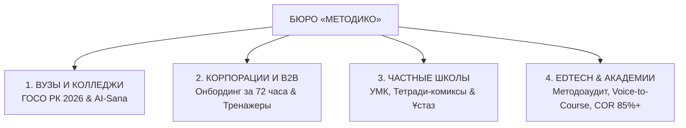
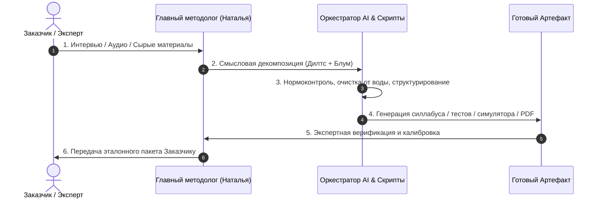

# 📖 КНИГА МЕТОДИКО: АРХИТЕКТУРА, СТАНДАРТЫ И ПОЛНЫЙ СВОД ДОКУМЕНТОВ БЮРО

> **Официальный свод стандартов и регламентов бюро «МЕТОДИКО»**  
> **Юридическое лицо:** ТОО «Метод и Ко» (г. Алматы, Республика Казахстан)  
> **Основатель и главный методолог:** [[ПАСПОРТ_КОМПЕТЕНЦИЙ_НАТАЛЬИ|Наталья Коденцева]] — Магистр педагогики, эксперт высшей школы по нормоконтролю и проектированию образовательных систем (24 года научно-педагогической и руководящей практики)  
> **Официальный веб-портал:** https://metodico-kz.netlify.app/  
> **Контакты:** Телефон / WhatsApp: `+7 (700) 077-35-66`

---

## СОДЕРЖАНИЕ КНИГИ

1. [РАЗДЕЛ I. Философско-методологический манифест бюро «МЕТОДИКО»](#раздел-i-философско-методологический-манифест-бюро-методико)
   - 1.1. Симбиоз двух стихий: Военный нормоконтроль и Гуманная педагогика сердца
   - 1.2. Профессиональный профиль и фундамент основателя
   - 1.3. Теоретический базис (Дилтс, Блум, Грейвз, Свеллер, CustDev, ФКР)
2. [РАЗДЕЛ II. Продуктовая экосистема: 4 флагманских направления](#раздел-ii-продуктовая-экосистема-4-флагманских-направления)
   - 2.1. Направление 1: Академический сектор (ГОСО РК 2026, «AI-Sana», «AI + X», Platonus/Moodle)
   - 2.2. Направление 2: Корпоративный сектор (Онбординг за 72 часа, диалоговые HTML5/SCORM симуляторы)
   - 2.3. Направление 3: Школьный сектор (Частные школы, авторские УМК, тетради-комиксы, аттестация «Ұстаз»)
   - 2.4. Направление 4: EdTech и Корпоративные академии (Методоаудит, Drop-off карта, Voice-to-Course, COR 85%+)
3. [РАЗДЕЛ III. Производственный конвейер и технологии разработки](#раздел-iii-производственный-конвейер-и-технологии-разработки)
   - 3.1. Технология Voice-to-Course: Сборка эталонных курсов и книг из аудио
   - 3.2. Архитектура интерактивных симуляторов переговоров
   - 3.3. Полиграфический стандарт рабочих тетрадей (Pre-press PDF)
4. [РАЗДЕЛ IV. Бронебойный юридический и финансовый каркас (Стандарт РК 2026)](#раздел-iv-бронебойный-юридический-и-финансовый-каркас-стандарт-рк-2026)
   - 4.1. Реквизиты и правовой статус ТОО «Метод и Ко»
   - 4.2. Механика защиты от потребительского экстремизма (лимит 3 правок, день-в-день, автоприемка, невозвратность)
   - 4.3. Финансовая политика, себестоимость и маржинальность
5. [РАЗДЕЛ V. Стратегия B2B-экспансии и каналы дистрибуции](#раздел-v-стратегия-b2b-экспансии-и-каналы-дистрибуции)
   - 5.1. Персонализированный аутрич (Вузы, Корпорации, Школы)
   - 5.2. Демо-воронка через интерактивный веб-симулятор
6. [РАЗДЕЛ VI. Сводный реестр документов и ссылочная матрица](#раздел-vi-сводный-реестр-документов-и-ссылочная-матрица)

---

## РАЗДЕЛ I. ФИЛОСОФСКО-МЕТОДОЛОГИЧЕСКИЙ МАНИФЕСТ БЮРО «МЕТОДИКО»

### 1.1. Симбиоз двух стихий: Военный нормоконтроль и Гуманная педагогика сердца

Бюро стандартов «МЕТОДИКО» создано на стыке двух уникальных начал, редко встречающихся в одном эксперте:

```
┌────────────────────────────────────────────────────────┐
│              ФИЛОСОФСКИЙ КАМЕРТОН «МЕТОДИКО»           │
├───────────────────────────┬────────────────────────────┤
│    ШТАБНОЙ НОРМОКОНТРОЛЬ  │ ГУМАННАЯ ПЕДАГОГИКА СЕРДЦА │
│  (Высшая военная школа)   │    (Шалва Амонашвили)      │
├───────────────────────────┼────────────────────────────┤
│ • 24 года службы и опыта  │ • Магистр педагогики       │
│ • Железобетонная структура│ • Принцип «зеленых чернил» │
│ • 100% точность формулировок│ • «Дорисовывание» личности│
│ • Нулевая терпимость к хаосу│ • Вера в потенциал ученика│
│ • Измеримые KPI, COR, NPS │ • Бережное наставничество  │
└───────────────────────────┴────────────────────────────┘
```

1. **Штабная системность и дисциплина высшей военной школы (24 года практики):**
   * Образовательный продукт проектируется как боевой устав: каждая цель обучения калибруется, каждое действие ученика диагностируется, исключаются двусмысленности, «вода» и хаотичные отступления.
   * Нормоконтроль документации проводится по высшим стандартам государственной регламентации.
2. **Гуманная педагогика сердца (канон Шалвы Амонашвили):**
   * Уважение к достоинству ученика и сотрудника.
   * Методология «зеленых чернил»: акцент на достижениях, победах и сильных сторонах вместо демотивирующего выискивания ошибок красной ручкой.
   * Приемы «дорисовывания» (обращение к человеку с позиции его высшего раскрытого потенциала) и «нашептывания на ухо» (деликатная коррекция без публичного стыжения).

---

### 1.2. Профессиональный профиль и фундамент основателя

* **Основатель:** **Наталья Коденцева** — Магистр педагогики, признанный главный методолог образовательных программ.
* **Трудовой стаж:** Более 24 лет непрерывной научно-педагогической, нормоконтрольной и административно-руководящей деятельности в системе высшего образования и прикладной подготовки кадров.
* **Портфолио реализованных программ:**
  * Автор и архитектор **более 300 курсов, учебных дисциплин и программ** всех направлений и масштабов (от фундаментальных университетских программ до прикладных корпоративных онбордингов).
  * Разработчик программ повышения квалификации для военной кафедры Казахского национального университета им. аль-Фараби в рамках государственного оборонного заказа (Договор № ОИ-ЦП-1-25).
  * Методолог социально значимого детского проекта безопасности «Миссия 112».
  * Архитектор систем дошкольного и раннего развития детей (включая стандарты сетей развития и программы «Жаңа Ұрпақ 365»).
  * Автор сертифицированного флагманского курса «Сам себе методолог» (Свидетельство о депонировании объекта авторских прав № 2215094 от 28.03.2024 г., международная регистрация IREG/InterPatent).

---

### 1.3. Теоретический базис и методологический инструментарий

В методологический арсенал бюро заложены признанные мировые научные концепции:

1. **Обратный дизайн (Backward Design, Grant Wiggins & Jay McTighe):**
   Проектирование курса начинается не с лекций, а с фиксации целевого результата:
   $$\text{Целевой результат (Что делает выпускник)} \longrightarrow \text{Критерии оценки (Как докажем)} \longrightarrow \text{Учебные активности (Как научим)}$$
2. **Таксономия Блума в редакции Андерсона и Кратволя (Bloom's Revised Taxonomy):**
   Исключение размытых глаголов («понимать», «ознакомиться»). Использование глаголов действия: *рассчитать, спроектировать, валидировать, устранить, составить*.
3. **Пирамида логических уровней Роберта Дилтса:**
   Перевод процесса обучения и продаж с уровней «Окружение» и «Поведение» на уровни «Способности», «Ценности» и «Идентичность».
4. **Спиральная динамика доктора Клэра Грейвза (Spiral Dynamics):**
   Адаптация корпоративных программ под доминирующую культуру организации (от синей культуры правил и порядка до оранжевой культуры личных побед и зеленой культуры согласия).
5. **Матрица глубинных проблем (CustDev) и ФКР (Функциональная карта роли):**
   Каждая строчка учебной программы отвечает на реальную выявленную «боль» и функциональную обязанность специалиста.
6. **Теория когнитивной нагрузки Джона Свеллера (Cognitive Load Theory):**
   Устранение посторонней когнитивной нагрузки (extraneous load) через микроформаты, инфографику и четкие визуальные чек-листы.

---

## РАЗДЕЛ II. ПРОДУКТОВАЯ ЭКОСИСТЕМА: 4 ФЛАГМАНСКИХ НАПРАВЛЕНИЯ



---

### 2.1. Направление 1: Академический сектор (ГОСО РК 2026, «AI-Sana», «AI + X», Platonus/Moodle)

* **Целевая аудитория:** Проректоры по академическим вопросам, деканаты, заведующие кафедрами вузов и директора колледжей (ТиПО) Казахстана.
* **Главный рыночный триггер:** Регуляторные требования МНВО РК 2026 года по внедрению национальной программы «AI-Sana», модели «AI + X», обязательной политике допустимого применения генеративного ИИ в силлабусах и тотальной валидации фондов оценочных средств (ФОС).
* **Созданные артефакты бюро:**
  * **Whitepaper стандарта:** [whitepaper-goso-2026.html](file:///c:/Users/Dell/Desktop/РАБОЧАЯ_ЗОНА/МЕТОДОЛОГИЯ/_ПРОЕКТ_ИССЛЕДОВАНИЕ_И_САЙТ/whitepaper-goso-2026.html)
  * **Техническое задание к договору:** [Приложение № 1 (Вузы и колледжи)](file:///c:/Users/Dell/Desktop/РАБОЧАЯ_ЗОНА/МЕТОДОЛОГИЯ/ТОО%20Метод%20и%20Ко/ДОГОВОР_2026/Приложение_1_ТЗ_ВУЗЫ_КОЛЛЕДЖИ_ГОСО_2026.md)
  * **B2B-обращение:** [Письмо ректоратам и деканатам](file:///c:/Users/Dell/Desktop/РАБОЧАЯ_ЗОНА/МЕТОДОЛОГИЯ/ТОО%20Метод%20и%20Ко/РАССЫЛКА_B2B/ПИСЬМО_1_РЕКТОРАТАМ_И_ДЕКАНАТАМ_ВУЗОВ.md)
* **Состав эталонного пакета:**
  1. Силлабус по ГОСО РК 2026 с регламентом «AI Policy 2026» и активными глаголами Блума (15 недель семестра);
  2. Банк из 100 тестовых заданий ФОС в кодировке UTF-8 (форматы GIFT / Aiken) для бесшовного импорта в Platonus / Moodle за 3 секунды;
  3. Критериальные рубрикаторы для рубежного контроля (РК-1, РК-2, сессия);
  4. Интерактивная HTML-панель запуска дисциплины для студентов.
* **Ценообразование:** 180 000 ₸ за дисциплину; кафедральный цикл (до 5–6 дисциплин) — **950 000 ₸**.

---

### 2.2. Направление 2: Корпоративный сектор (Онбординг за 72 часа, диалоговые HTML5/SCORM симуляторы)

* **Целевая аудитория:** Генеральные директора, коммерческие директора (CCO), директора по продажам (РОП) и HRD компаний сегментов B2B и B2C.
* **Главный рыночный триггер:** Новички в продажах «сливают» от 35% до 50% целевого рекламного трафика в первые недели работы из-за страха возражений («Қымбат / Дорого», «Скиньте на WhatsApp», «Я подумаю»), а классическая адаптация отнимает месяц времени РОПа.
* **Созданные артефакты бюро:**
  * **Whitepaper стандарта:** [whitepaper-corporate-sales.html](file:///c:/Users/Dell/Desktop/РАБОЧАЯ_ЗОНА/МЕТОДОЛОГИЯ/_ПРОЕКТ_ИССЛЕДОВАНИЕ_И_САЙТ/whitepaper-corporate-sales.html)
  * **Действующий интерактивный симулятор:** [case-1-sales-simulator.html](file:///c:/Users/Dell/Desktop/РАБОЧАЯ_ЗОНА/МЕТОДОЛОГИЯ/_ПРОЕКТ_ИССЛЕДОВАНИЕ_И_САЙТ/case-1-sales-simulator.html)
  * **Техническое задание к договору:** [Приложение № 2 (Корпоративный онбординг)](file:///c:/Users/Dell/Desktop/РАБОЧАЯ_ЗОНА/МЕТОДОЛОГИЯ/ТОО%20Метод%20и%20Ко/ДОГОВОР_2026/Приложение_2_ТЗ_КОРПОРАТИВНЫЙ_ОНБОРДИНГ_И_ТРЕНАЖЕРЫ.md)
  * **B2B-обращение:** [Письмо генеральным директорам и РОПам](file:///c:/Users/Dell/Desktop/РАБОЧАЯ_ЗОНА/МЕТОДОЛОГИЯ/ТОО%20Метод%20и%20Ко/РАССЫЛКА_B2B/ПИСЬМО_2_ГЕНЕРАЛЬНЫМ_ДИРЕКТОРАМ_И_РОПАМ.md)
* **Состав эталонного пакета:**
  1. Интерактивный диалоговый HTML5/SCORM-симулятор (до 3 ключевых сценариев: квалификация, отработка «Қымбат/Дорого», дожим КП) с аудиорепликами клиентов и расчетом баллов;
  2. Дорожная карта онбординга «Сотрудник в строю за 72 часа» (День 1 — правила и продукт; День 2 — тренажер до балла 85+; День 3 — выход в звонки под контролем наставника);
  3. Стандарт операционных процедур (SOP) и боевой скрипт-бук с учетом казахской и русской речевой культуры;
  4. Чек-лист контроля качества звонков (QA / Audit Sheet) для автоматизированного аудита разговоров РОПом.
* **Ценообразование:** Базовый симулятор на 3 сценария — **650 000 ₸**; Корпоративный комплекс Enterprise — **1 200 000 ₸**.

---

### 2.3. Направление 3: Школьный сектор (Частные школы, авторские УМК, тетради-комиксы, аттестация «Ұстаз»)

* **Целевая аудитория:** Учредители, директора частных школ, лицеев, гимназий и авторских образовательных центров.
* **Главный рыночный триггер:** Родители требуют доказательств эксклюзивности платного обучения и жалуются на сухие типовые учебники; сильные педагоги перегружены и не успевают собирать портфолио к аттестации «Ұстаз» (педагог-модератор, сарапшы, зерттеуші, шебер).
* **Созданные артефакты бюро:**
  * **Whitepaper стандарта:** [whitepaper-ustaz-school.html](file:///c:/Users/Dell/Desktop/РАБОЧАЯ_ЗОНА/МЕТОДОЛОГИЯ/_ПРОЕКТ_ИССЛЕДОВАНИЕ_И_САЙТ/whitepaper-ustaz-school.html)
  * **Техническое задание к договору:** [Приложение № 3 (Школы и «Ұстаз»)](file:///c:/Users/Dell/Desktop/РАБОЧАЯ_ЗОНА/МЕТОДОЛОГИЯ/ТОО%20Метод%20и%20Ко/ДОГОВОР_2026/Приложение_3_ТЗ_ШКОЛЫ_АВТОРСКИЕ_УМК_И_ТЕСТ_УСТАЗ.md)
  * **B2B-обращение:** [Письмо учредителям и директорам школ](file:///c:/Users/Dell/Desktop/РАБОЧАЯ_ЗОНА/МЕТОДОЛОГИЯ/ТОО%20Метод%20и%20Ко/РАССЫЛКА_B2B/ПИСЬМО_3_ДИРЕКТОРАМ_ЧАСТНЫХ_ШКОЛ_И_ЛИЦЕЕВ.md)
* **Состав эталонного пакета:**
  1. Авторская учебная программа и Календарно-тематический план (КТП) на 34 или 68 часов по обновленным нормам Минпросвещения РК;
  2. Оригинал-макет фирменной Рабочей тетради-комикса (Pre-press PDF, CMYK, 300 DPI, векторная графика, до 40–60 полос) — осязаемый премиальный продукт школы для печати в типографии;
  3. Критериальный аппарат: формулировки и рубрикаторы для ФО, СОР и СОЧ;
  4. Аттестационный паспорт программы с официальной рецензией магистра педагогики для защиты категории на экспертном совете.
* **Ценообразование:** Предпечатная верстка тетради-комикса — **180 000 ₸**; Авторский спецкурс (34 ч) — **350 000 ₸**; Флагманский комплекс (68 ч + тетрадь + «Ұстаз») — **850 000 ₸**.

---

### 2.4. Направление 4: EdTech и Корпоративные академии (Методоаудит, Drop-off карта, Voice-to-Course, COR 85%+)

* **Целевая аудитория:** Владельцы онлайн-школ, продюсеры экспертов, руководители корпоративных университетов и L&D отделов.
* **Главный рыночный триггер:** Средняя доходимость онлайн-курсов на рынке СНГ составляет всего 12–18%. Студенты тонут в часовых «говорящих головах», срывают дедлайны домашних заданий и требуют возвратов. Эксперты выгорают на этапе написания методических материалов.
* **Созданные артефакты бюро:**
  * **Whitepaper стандарта:** [whitepaper-edtech-audit.html](file:///c:/Users/Dell/Desktop/РАБОЧАЯ_ЗОНА/МЕТОДОЛОГИЯ/_ПРОЕКТ_ИССЛЕДОВАНИЕ_И_САЙТ/whitepaper-edtech-audit.html)
  * **Техническое задание к договору:** [Приложение № 4 (EdTech и Voice-to-Course)](file:///c:/Users/Dell/Desktop/РАБОЧАЯ_ЗОНА/МЕТОДОЛОГИЯ/ТОО%20Метод%20и%20Ко/ДОГОВОР_2026/Приложение_4_ТЗ_EDTECH_АУДИТ_И_VOICE_TO_COURSE.md)
* **Состав эталонного пакета:**
  1. Экспертное заключение аудита и Карта оттока (Drop-off Map) с поурочным выявлением когнитивных барьеров;
  2. Voice-to-Course распаковка: перевод аудиозаписей эксперта (до 3–6 часов) в структурированные сценарии микроуроков (по 7–12 мин), саммари и конспекты;
  3. Критериальная шкала проверки ДЗ для службы кураторов (регламент ответа за 15 мин по принципу «зеленых чернил»);
  4. Оригинал-макет Рабочей тетради студента (Student Workbook) для практического закрепления навыка.
* **Ценообразование:** Экспресс-аудит + Drop-off карта — **250 000 ₸**; Voice-to-Course модуль — **550 000 ₸**; Флагманский онлайн-курс под ключ (COR 85%+) — **1 100 000 ₸**.

---

## РАЗДЕЛ III. ПРОИЗВОДСТВЕННЫЙ КОНВЕЙЕР И ТЕХНОЛОГИИ РАЗРАБОТКИ



### 3.1. Технология Voice-to-Course: Сборка эталонных курсов и книг из аудио

Самый частый барьер экспертов — невозможность сесть и написать структурированный текст («нет времени писать методичку на 100 страниц»).

**Регламент Voice-to-Course в «МЕТОДИКО»:**
1. **Глубинная сессия распаковки (1,5–3 часа аудио):** Методолог ведет эксперта по матрице логических уровней, задавая фокусирующие вопросы («Какое первое действие делает новичок?», «В чем главная ошибка?», «Как отличить плохой результат от блестящего?»).
2. **Фоновая транскрибация и очистка:** Аудио переводится в текст, удаляются слова-паразиты, междометия и смысловые повторы.
3. **Методологическая сборка:** Текст квантуется на микромодули:
   * *Крючок внимания (Hook) — 1 минута;*
   * *Концептуальное правило (Rule) — 3 минуты;*
   * *Разбор кейса / антикейса (Case Study) — 4 минуты;*
   * *Пошаговый алгоритм действия (SOP) — 2 минуты;*
   * *Конкретное практическое задание (Action Item) — 2 минуты.*
4. **Сборка книги / воркбука:** Вся программа верстается в единый методический свод с таблицами, схемами и чек-листами.

---

### 3.2. Архитектура интерактивных диалоговых тренажеров (HTML5 / SCORM)

Диалоговый симулятор «МЕТОДИКО» — это автономное веб-приложение, работающее на нативном стекe (HTML5, modern CSS, vanilla JavaScript):
* **Полная автономность:** Не требует установки сторонних серверов или баз данных. Запускается локально двойным кликом на любом компьютере, смартфоне или встраивается через `<iframe>` в любую корпоративную систему (Bitrix24, AmoCRM, WebTutor, Teachbase, GetCourse, Moodle).
* **Сценарный движок:** Представляет собой ориентированный граф (дерево состояний). В каждом узле диалога воспроизводится аудиозапись реплики клиента (с использованием Web Audio API / синтеза речи) и отображаются 3 варианта ответа менеджера:
  * *Критическая ошибка (минус балл, переход на ветку ухода клиента);*
  * *Посредственный ответ (нейтральный балл, затягивание разговора);*
  * *Эталонная отработка (максимальный балл, раскрытие возражения по Дилтсу, переход к закрытию сделки).*
* **Аналитический блок:** Ведет подсчет итоговой конверсии, тайминг времени реакции и выдает подробную рецензию с объяснением допущенных ошибок.

---

### 3.3. Полиграфический стандарт рабочих тетрадей (Pre-press PDF)

Для исключения затрат на хранение и пересылку физических тиражей «МЕТОДИКО» передает Заказчикам файлы в абсолютном полиграфическом стандарте:
* Цветовая модель: **CMYK** (европейский профиль Fogra 39 / ISO Coated v2);
* Разрешение растровых элементов: **300 DPI**;
* Все шрифты переведены в кривые или встроены в контейнер PDF/X-1a:2001;
* Вылеты под обрез (bleed): строго **+2 мм** с каждой стороны;
* Файл принимается любой типографией Казахстана и мира без единого замечания препресса.

---

## РАЗДЕЛ IV. БРОНЕБОЙНЫЙ ЮРИДИЧЕСКИЙ И ФИНАНСОВЫЙ КАРКАС (СТАНДАРТ РК 2026)

### 4.1. Реквизиты и правовой статус ТОО «Метод и Ко»

* **Полное наименование:** Товарищество с ограниченной ответственностью «Метод и Ко»
* **Юридический адрес:** Республика Казахстан, г. Алматы, Бостандыкский район, пр. Гагарина, дом 135/3, кв. 73
* **Бизнес-идентификационный номер (БИН):** `231140018015`
* **Банковские реквизиты:**
  * Банк: АО «Kaspi Bank»
  * ИИК (IBAN): `KZ54722S000031140138`
  * БИК: `CASPKZKA`
* **ОКЭД (Виды экономической деятельности):**
  * `85.59.9` — Прочая деятельность в области образования, не включенная в другие группировки;
  * `85.60.9` — Вспомогательные образовательные услуги.
* **Налоговый статус и регламент активации:**
  * В настоящее время налоговая отчетность приостановлена в строгом соответствии со статьей 213 Налогового кодекса РК (Решение УГД по Бостандыкскому району г. Алматы от 29.11.2025 г.).
  * На публичной витрине сайта числовой БИН скрыт в целях информационной безопасности (указывается статус: «Договор с ТОО • ЭСФ, АВР»).
  * При подписании реального крупного B2B-договора деятельность ТОО возобновляется онлайн через кабинет налогоплательщика `cabinet.salyk.kz` **в течение 1 рабочего дня** подачей электронного заявления без штрафов и пошлин.

---

### 4.2. Механика защиты от потребительского экстремизма («Железный договор»)

В разработанном договоре авторского заказа `ДОГОВОР_АВТОРСКОГО_ЗАКАЗА_МЕТОДИКО_2026.md` заложены 4 бронебойных юридических механизма защиты эксперта:

```
┌────────────────────────────────────────────────────────┐
│             4 ЩИТА АВТОРСКОГО ДОГОВОРА «МЕТОДИКО»      │
├───────────────────────────┬────────────────────────────┤
│ 1. ЛИМИТ 3 ПРАВОК         │ 2. ПРАВИЛО «ДЕНЬ-В-ДЕНЬ»   │
│ Защита от вкусовщины и    │ Задержка исходных данных   │
│ бесконечных переделок     │ автоматически продлевает   │
│ (п. 4.2 Договора)         │ сроки сдачи (п. 4.4)       │
├───────────────────────────┼────────────────────────────┤
│ 3. АВТОПРИЕМКА ЗА 3 ДНЯ   │ 4. НЕВОЗВРАТНОСТЬ ИС       │
│ Молчание Заказчика        │ Защита по ст. 963 ГК РК:   │
│ юридически признается     │ результат интеллектуального│
│ полной приемкой (п. 4.5)  │ труда не подлежит возврату │
└───────────────────────────┴────────────────────────────┘
```

1. **Лимит правок (п. 4.2):** Заказчик имеет право не более чем на **3 (три) раунда замечаний**, которые должны носить характер конкретных замечаний по тексту в рамках утвержденного Технического задания. Запрещается изменение первоначальной концепции.
2. **Сдвиг сроков «день-в-день» (п. 4.4):** Если Заказчик задерживает предоставление доступов, текстов или согласование промежуточных этапов более чем на 2 рабочих дня, общий срок выполнения работ автоматически отодвигается на эквивалентное количество дней плюс 2 рабочих дня на восстановление производственного цикла.
3. **Безусловная автоприемка работ (п. 4.5):** Если в течение 3 (трех) рабочих дней с момента отправки Акта выполненных работ Заказчик не подписывает Акт и не направляет мотивированный письменный отказ, работы считаются принятыми в полном объеме, подлежат 100% оплате, а односторонний Акт имеет полную юридическую силу.
4. **Защита от необоснованных возвратов (п. 6.3 и ст. 963 ГК РК):** Произведения науки, литературы и учебно-методического проектирования представляют собой нематериальный авторский труд. Исполнитель не несет ответственности за решения государственных аккредитационных комиссий, коммерческие показатели продаж или субъективное восприятие третьих лиц.

---

### 4.3. Финансовая модель и маржинальность

* **Базовая ставка экспертного нормоконтроля Натальи Коденцевой:** `15 000 ₸ / час`.
* **Экономика пакетов:**

| Направление | Пакет | Цена Заказчику (₸) | Трудозатраты эксперта | Себестоимость (₸) | Маржинальность (%) |
| :--- | :--- | :---: | :---: | :---: | :---: |
| Вузы / Колледжи | 1 Силлабус + ФОС | 180 000 ₸ | 4 часа | 60 000 ₸ | **66.6%** |
| Вузы / Колледжи | Кафедральный цикл (5 дисц.) | 950 000 ₸ | 18 часов | 270 000 ₸ | **71.5%** |
| Корпорации | Базовый тренажер (3 сцен.) | 650 000 ₸ | 12 часов | 180 000 ₸ | **72.3%** |
| Корпорации | Enterprise комплекс | 1 200 000 ₸ | 24 часа | 360 000 ₸ | **70.0%** |
| Частные школы | Вёрстка тетради-комикса | 180 000 ₸ | 4 часа | 60 000 ₸ | **66.6%** |
| Частные школы | Курс 34ч + тетрадь | 350 000 ₸ | 8 часов | 120 000 ₸ | **65.7%** |
| Частные школы | Флагман 68ч + «Ұстаз» | 850 000 ₸ | 16 часов | 240 000 ₸ | **71.7%** |
| EdTech | Аудит + Drop-off карта | 250 000 ₸ | 5 часов | 75 000 ₸ | **70.0%** |
| EdTech | Voice-to-Course модуль | 550 000 ₸ | 11 часов | 165 000 ₸ | **70.0%** |
| EdTech | Флагманский курс под ключ | 1 100 000 ₸ | 22 часа | 330 000 ₸ | **70.0%** |

---

## РАЗДЕЛ V. СТРАТЕГИЯ B2B-ЭКСПАНСИИ И КАНАЛЫ ДИСТРИБУЦИИ

### 5.1. Персонализированный B2B-аутрич

Вместо спама используется адресная точечная отправка писем лицам, принимающим решения (ЛПР), через email и WhatsApp-бизнес с персонализацией первых двух абзацев:
1. **Канал «Вузы и колледжи»:** Проректоры по УВР, деканы профильных факультетов (IT, экономика, педагогика, юриспруденция). Тема письма апеллирует к директиве МНВО РК и проекту «AI-Sana».
2. **Канал «Коммерческие директора и РОПы»:** Компании с численностью отдела продаж от 5 человек. Письмо бьет в слив лидов и предлагает кликнуть по ссылке на действующий демо-тренажер.
3. **Канал «Частные школы и лицеи»:** Учредители и директора. Письмо акцентирует внимание на защите родительской оплаты и подготовке учителей к тестированию «Ұстаз».

---

## РАЗДЕЛ VI. СВОДНЫЙ РЕЕСТР ДОКУМЕНТОВ И ССЫЛОЧНАЯ МАТРИЦА

| № | Категория артефакта | Наименование документа | Локальный путь / Ссылка |
| :-: | :--- | :--- | :--- |
| 1 | **Юридический базис** | Генеральный договор авторского заказа 2026 | [ДОГОВОР_2026.md](file:///c:/Users/Dell/Desktop/РАБОЧАЯ_ЗОНА/МЕТОДОЛОГИЯ/ТОО%20Метод%20и%20Ко/ДОГОВОР_2026/ДОГОВОР_АВТОРСКОГО_ЗАКАЗА_МЕТОДИКО_2026.md) |
| 2 | **ТЗ и Спецификация** | Приложение № 1: Вузы и колледжи (ГОСО РК 2026) | [Приложение_1_ТЗ_ВУЗЫ.md](file:///c:/Users/Dell/Desktop/РАБОЧАЯ_ЗОНА/МЕТОДОЛОГИЯ/ТОО%20Метод%20и%20Ко/ДОГОВОР_2026/Приложение_1_ТЗ_ВУЗЫ_КОЛЛЕДЖИ_ГОСО_2026.md) |
| 3 | **ТЗ и Спецификация** | Приложение № 2: Онбординг 72ч и диалоговые тренажеры | [Приложение_2_ТЗ_ОНБОРДИНГ.md](file:///c:/Users/Dell/Desktop/РАБОЧАЯ_ЗОНА/МЕТОДОЛОГИЯ/ТОО%20Метод%20и%20Ко/ДОГОВОР_2026/Приложение_2_ТЗ_КОРПОРАТИВНЫЙ_ОНБОРДИНГ_И_ТРЕНАЖЕРЫ.md) |
| 4 | **ТЗ и Спецификация** | Приложение № 3: Частные школы, тетради и «Ұстаз» | [Приложение_3_ТЗ_ШКОЛЫ.md](file:///c:/Users/Dell/Desktop/РАБОЧАЯ_ЗОНА/МЕТОДОЛОГИЯ/ТОО%20Метод%20и%20Ко/ДОГОВОР_2026/Приложение_3_ТЗ_ШКОЛЫ_АВТОРСКИЕ_УМК_И_ТЕСТ_УСТАЗ.md) |
| 5 | **ТЗ и Спецификация** | Приложение № 4: EdTech аудит, Voice-to-Course, COR 85%+ | [Приложение_4_ТЗ_EDTECH.md](file:///c:/Users/Dell/Desktop/РАБОЧАЯ_ЗОНА/МЕТОДОЛОГИЯ/ТОО%20Метод%20и%20Ко/ДОГОВОР_2026/Приложение_4_ТЗ_EDTECH_АУДИТ_И_VOICE_TO_COURSE.md) |
| 6 | **B2B-аутрич** | Письмо 1: Ректоратам и деканатам вузов | [ПИСЬМО_1_РЕКТОРАТАМ.md](file:///c:/Users/Dell/Desktop/РАБОЧАЯ_ЗОНА/МЕТОДОЛОГИЯ/ТОО%20Метод%20и%20Ко/РАССЫЛКА_B2B/ПИСЬМО_1_РЕКТОРАТАМ_И_ДЕКАНАТАМ_ВУЗОВ.md) |
| 7 | **B2B-аутрич** | Письмо 2: Генеральным директорам и РОПам | [ПИСЬМО_2_РОПАМ.md](file:///c:/Users/Dell/Desktop/РАБОЧАЯ_ЗОНА/МЕТОДОЛОГИЯ/ТОО%20Метод%20и%20Ко/РАССЫЛКА_B2B/ПИСЬМО_2_ГЕНЕРАЛЬНЫМ_ДИРЕКТОРАМ_И_РОПАМ.md) |
| 8 | **B2B-аутрич** | Письмо 3: Учредителям частных школ и лицеев | [ПИСЬМО_3_ШКОЛАМ.md](file:///c:/Users/Dell/Desktop/РАБОЧАЯ_ЗОНА/МЕТОДОЛОГИЯ/ТОО%20Метод%20и%20Ко/РАССЫЛКА_B2B/ПИСЬМО_3_ДИРЕКТОРАМ_ЧАСТНЫХ_ШКОЛ_И_ЛИЦЕЕВ.md) |
| 9 | **Веб-витрина** | Главный портал бюро стандартов «МЕТОДИКО» | [index.html](file:///c:/Users/Dell/Desktop/РАБОЧАЯ_ЗОНА/МЕТОДОЛОГИЯ/_ПРОЕКТ_ИССЛЕДОВАНИЕ_И_САЙТ/index.html) |
| 10 | **Интерактив** | Действующий диалоговый тренажер продаж | [case-1-sales-simulator.html](file:///c:/Users/Dell/Desktop/РАБОЧАЯ_ЗОНА/МЕТОДОЛОГИЯ/_ПРОЕКТ_ИССЛЕДОВАНИЕ_И_САЙТ/case-1-sales-simulator.html) |
| 11 | **Whitepaper 1** | Нормативная спецификация: ГОСО РК 2026 и Вузы | [whitepaper-goso-2026.html](file:///c:/Users/Dell/Desktop/РАБОЧАЯ_ЗОНА/МЕТОДОЛОГИЯ/_ПРОЕКТ_ИССЛЕДОВАНИЕ_И_САЙТ/whitepaper-goso-2026.html) |
| 12 | **Whitepaper 2** | Нормативная спецификация: B2B продажи и онбординг | [whitepaper-corporate-sales.html](file:///c:/Users/Dell/Desktop/РАБОЧАЯ_ЗОНА/МЕТОДОЛОГИЯ/_ПРОЕКТ_ИССЛЕДОВАНИЕ_И_САЙТ/whitepaper-corporate-sales.html) |
| 13 | **Whitepaper 3** | Нормативная спецификация: Частные школы и «Ұстаз» | [whitepaper-ustaz-school.html](file:///c:/Users/Dell/Desktop/РАБОЧАЯ_ЗОНА/МЕТОДОЛОГИЯ/_ПРОЕКТ_ИССЛЕДОВАНИЕ_И_САЙТ/whitepaper-ustaz-school.html) |
| 14 | **Whitepaper 4** | Нормативная спецификация: EdTech аудит и Voice-to-Course | [whitepaper-edtech-audit.html](file:///c:/Users/Dell/Desktop/РАБОЧАЯ_ЗОНА/МЕТОДОЛОГИЯ/_ПРОЕКТ_ИССЛЕДОВАНИЕ_И_САЙТ/whitepaper-edtech-audit.html) |
| 15 | **Аналитика** | Комплексный аудит рынка методологии СНГ и РК 2026 | [АНАЛИТИЧЕСКИЙ_ОТЧЕТ_РЫНОК_МЕТОДОЛОГИИ_2026.md](file:///c:/Users/Dell/Desktop/РАБОЧАЯ_ЗОНА/МЕТОДОЛОГИЯ/АНАЛИТИЧЕСКИЙ_ОТЧЕТ_РЫНОК_МЕТОДОЛОГИИ_2026.md) |
| 16 | **Навигация** | Главный дашборд Второго Мозга Натальи | [_ГЛАВНЫЙ_ДАШБОРД.md](file:///c:/Users/Dell/Desktop/РАБОЧАЯ_ЗОНА/МЕТОДОЛОГИЯ/_ГЛАВНЫЙ_ДАШБОРД.md) |

---
*Документ утвержден и принят к руководству как фундаментальный регламент Бюро академических и корпоративных стандартов «МЕТОДИКО».*  
*Дата актуализации: 11 ноября 2026 г.*
